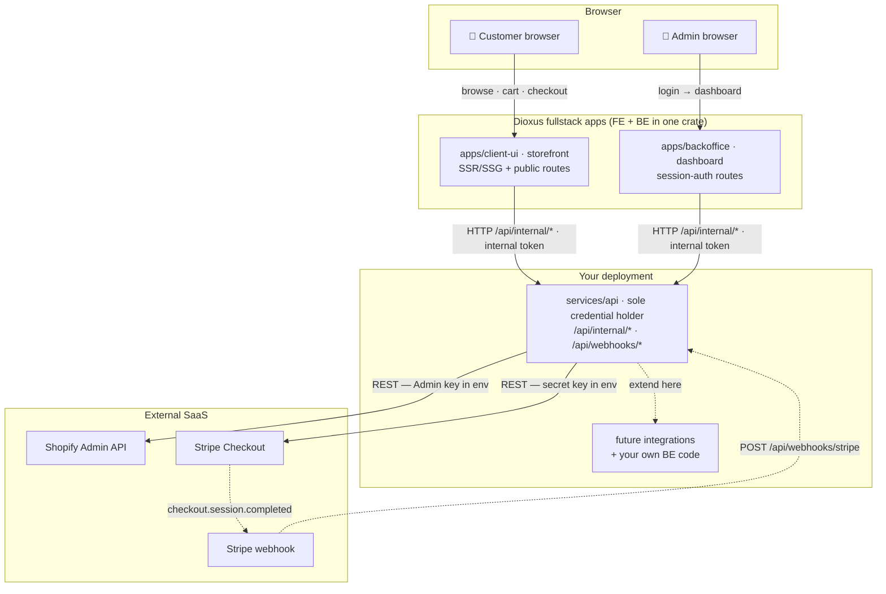

# Architecture — service graph

Three runnable units + one shared types crate. All third-party credentials
(Shopify Admin API, Stripe, future integrations) live in **one** place:
`services/api`.

## Rules that make this safe

1. **Credential isolation** — only the api service holds Shopify/Stripe secrets. A
   compromised storefront cannot reach the Admin API or charge cards.
2. **Apps talk to the api service, never to SaaS** — shared internal token over
   `/api/internal/*`. The api service translates into third-party calls.
3. **`crates/domain` is the contract** — Money, Product, Order, Report types
   serialized at the app↔api boundary; no other cross-crate data flow.
4. **Extending the api service** — add `integrations/<name>.rs` (shopify, stripe,
   then yours): one small namespace, one place to audit keys. See ROADMAP.

## `services/api` code style — functional core, imperative shell

The api service is written in a **pure-functional style**: no domain structs with
methods and no domain traits/interfaces. Everything is a free function; the only
effect (Postgres) is passed explicitly as `&PgPool`.

- **Pure core** (`services/*`): deterministic decisions — pagination shaping
  (`build_list_response`), delete authorization (`resolve_delete`), own-record
  authz (`ensure_self`), and token math (`generate_jwt`, `generate_random_token`,
  `hash_token`). These are plain functions over values and are unit-tested with no
  database, no mocks, no async.
- **Imperative shell** (`repositories/*`, the async parts of `services/*`):
  `pub async fn`s that take `&PgPool`, run the SQL, and hand results to the pure
  core. Tested against a real, disposable Postgres via `testcontainers`.
- **Handlers/middleware** are plain `pub async fn`s (no `AdminHandler`/
  `AuthHandler`/`Middleware` wrapper structs). Routers reference them directly,
  e.g. `get(admin::list)`.
- **`AppState`** is a plain data record `{ pool, settings }` built by
  `state::app_state`. There is no dependency-injection container and no
  `Arc<dyn Trait>` seam — with no mocking, a trait object would be dead weight.

What is kept and why: `impl IntoResponse for AppError`, `#[derive(FromRow)]`, and
`sqlx::Type` on domain types are **framework adapter typeclass instances**, not
OOP — they are required for axum/sqlx interop and carry no domain behavior.

### Testing

- Function-level tests: `cargo test -p api --lib` (no Docker, no Postgres). CI runs these.
- E2e tests: `cargo test -p api --test e2e` — one test per API endpoint against a real
  Postgres via testcontainers. Local only (needs Docker); not gated in CI.

`mockall` and hand-written fakes were removed. There is no mock store: services take
`&PgPool` directly and the e2e suite exercises the real database.