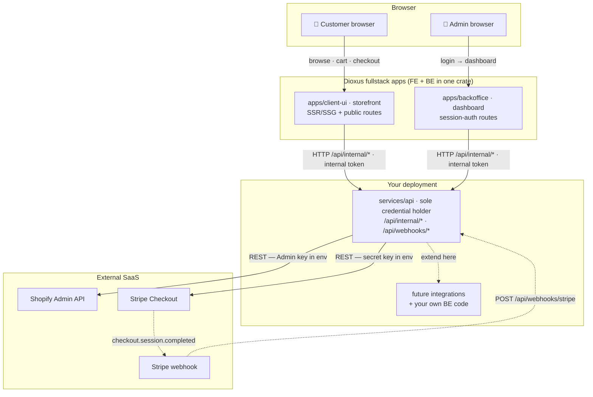

# Architecture — service graph

Three runnable units + one shared types crate. All third-party credentials
(Shopify Admin API, Stripe, future integrations) live in **one** place:
`services/api`.

## Rules that make this safe

1. **Credential isolation** — only the api service holds Shopify/Stripe secrets. A
   compromised storefront cannot reach the Admin API or charge cards.
2. **Apps talk to the api service, never to SaaS** — shared internal token over
   `/api/internal/*`. The api service translates into third-party calls.
3. **`crates/domain` is the contract** — Money, Product, Order, Report types
   serialized at the app↔api boundary; no other cross-crate data flow.
4. **Extending the api service** — add `integrations/<name>.rs` (shopify, stripe,
   then yours): one small namespace, one place to audit keys. See ROADMAP.