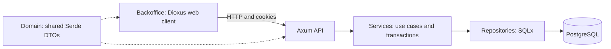
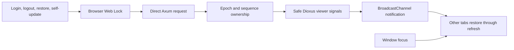

# Architecture and branch summary

| Snapshot | Value |
| --- | --- |
| Date / branch | 2026-10-13 / `feat/backoffice-admin-ui` |
| Scope | Current branch relative to `main`; cleanup scope includes the approved test-runner and TOML corrections |
| Related docs | [Operations](development.md) · [Verification](verification.md) |

## Ownership



| Package | Owns | Boundary |
| --- | --- | --- |
| `crates/domain` | Request/response DTOs, wire `AdminRole` | No database models, SQLx, claims or transactions |
| `services/api` | HTTP, authorization, credentials, cookies, CORS, PostgreSQL | All persistence and credential operations |
| `apps/backoffice` | Pages, forms, safe viewer state, browser synchronization | Direct Axum calls; client-only |
| `apps/client-ui` | Existing placeholder app | Outside this backoffice implementation |

## Project structure

| Root | Path | Responsibility |
| --- | --- | --- |
| `crates/domain` | `src/dto/{admin,auth}.rs` | Shared contracts |
| | `tests/contracts.rs` | Public serialization contract |
| `services/api` | `src/{lib,main}.rs` | Module registration; startup, listener, maintenance, shutdown |
| | `src/{config,state}.rs` | Settings, pool and signing key |
| | `src/routes/` | healthz and v1 route composition |
| | `src/handlers/` | HTTP inputs, responses, cookie transport |
| | `src/middleware/token.rs` | Bearer/cookie access-token authentication, JWT validation and role checks |
| | `src/middleware/cookies.rs` | Cookie transport, session mode and browser-origin guard |
| | `src/services/` | Validation, permissions and transaction boundaries |
| | `src/repositories/` | SQLx queries and retention |
| | `src/models/` | Rows, database roles, claims and principals |
| | `src/validations/` | Credential, pagination and account-action rules |
| | `src/utils/password.rs` | Argon2 hashing/verification |
| | `src/error.rs` | Error mapping and centralized failure logging |
| | `src/tests/` | Unit tests mirroring production modules |
| | `e2e-test/` | Real TCP tests mirroring API routes; Cargo test target `e2e` |
| | `migrations/` / `.sqlx/` | Schema migrations / offline query metadata |
| `apps/backoffice` | `src/lib.rs` | Module declarations |
| | `src/main.rs` | Dioxus launch, startup orchestration and root App components |
| | `application.toml` / `src/config.rs` | Public settings file / typed startup reader |
| | `src/api.rs` | Shared HTTP request construction, decoding and errors |
| | `src/api/` | Auth/admin endpoint calls |
| | `src/session/` | Safe viewer signals, response ownership, browser sync |
| | `src/route.rs` | UI routes and layout |
| | `src/pages/` | Login, home, profile, navbar, admin management |
| | `src/pages/admin/` | Create form, row and table components |
| | `src/components/` | Shared form, error and confirmation components |
| | `src/tests/api.rs` | HTTP request/configuration boundary unit tests |
| | `src/tests/config.rs` | Nested-route/base-path/invalid-URL asset resolution |
| | `src/tests/session/mod.rs` | Response-ownership unit test |

| Convention | Mapping |
| --- | --- |
| Function order | Exported functions → private helpers |
| Unit tests | `src/utils/password.rs` → `src/tests/utils/password.rs` |
| Private access | Test-gated child-module declaration; helpers remain private |
| Auth E2E | `src/routes/v1/auth.rs` → `e2e-test/v1/auth.rs` |
| Admin E2E | `src/routes/v1/admins.rs` → `e2e-test/v1/admins.rs` |
| E2E registration | API `Cargo.toml` → `e2e-test/main.rs` |
| Shared E2E utilities | `e2e-test/common.rs`: owned temporary TOML, local child API, readiness, `send`, fixture cleanup; endpoint helpers stay with endpoints |

## HTTP and authentication

```mermaid
sequenceDiagram
    participant UI as Backoffice client
    participant API as Axum API
    participant DB as PostgreSQL
    UI->>API: Login JSON, cookie mode, Origin
    API->>DB: Load account; store new refresh family
    API-->>UI: Safe session JSON; HttpOnly cookie
    UI->>API: Protected request with Cookie
    API->>API: Validate JWT; authorize request
    API-->>UI: DTO response
    UI->>API: Refresh with Cookie and Origin
    API->>DB: Consume old refresh; insert replacement in transaction
    API-->>UI: Safe session JSON; rotated cookie
```

| Operation | Server behavior |
| --- | --- |
| Login | One Argon2 verification; new refresh family per login |
| Access | JWT signature/expiry; 600-second lifetime + 60-second leeway |
| Refresh | Single-use consumption + replacement in one transaction; same family |
| Logout | Revoke current authenticated account's refresh family |
| Account/password update | Update + all target refresh revocations in one transaction |
| Account deletion | Foreign-key cascade removes refresh credentials |
| Access after revocation | Existing JWT remains valid until its expiry window ends |
| Write authorization | Route checks plus current actor lookup in services; UI checks are presentation only |

| Browser transport | Policy |
| --- | --- |
| Request | `x-session-mode: cookie`; browser credentials included |
| Login/refresh JSON | `SessionResponse`: identity, role, expiry; no token pair |
| Cookie | Access/refresh pair; HttpOnly, SameSite=Lax, Path=/; seven days |
| Production | Secure `__Host-backoffice_auth`; no Domain |
| Explicit loopback HTTP | `backoffice_auth`; insecure-local mode |
| Clearing | Successful cookie logout and self-update |
| Bearer clients | Token JSON and refresh-request bodies retained |
| Bearer precedence | Present invalid bearer rejects; no cookie fallback |
| CORS | Credentialed requests from exact `browser.public_origin` in TOML |
| Mutation origin | Cookie requests reject missing/null/foreign Origin |
| Caching | Responses passing through cookie guard: `Cache-Control: no-store` |
| Site assumption | UI/API same-site; use consistent local host spelling |



| Coordination | Guarantee / limit |
| --- | --- |
| Web Locks | Serialize same-origin cookie-changing UI operations; support required |
| Epoch/sequence | Reject stale results after account transitions |
| Restoration | Existing refresh endpoint; legacy LocalStorage credentials removed |
| Independent logins | Separate refresh families |
| Transactions | Atomic writes within each operation |
| Concurrent revocation | In-flight issuance can outlive revocation; no global serialization guarantee |
| Demonstrated race | Login verified before password update can issue credentials after revocation |

## Branch changes

| Area | Final state |
| --- | --- |
| Backoffice UI | Login, profile, admin management; reusable forms, confirmation, rows and tables |
| Entry points | Backoffice modules in `lib.rs`; startup/root components in `main.rs`; standalone API listener |
| Shared contracts | Persistence/internal auth types moved from domain into API |
| Browser transport | Axum owns cookies, origin guard and CORS; Dioxus BFF removed |
| Middleware | Cookie helpers/guard in `cookies.rs`; JWT authentication/role checks in `token.rs` |
| Client HTTP | Shared helpers in `api.rs`; named exports; endpoint calls in `api/{auth,admins}.rs`; explicit error statuses |
| Configuration cleanup | Browser asset resolved against page URL; API non-secret settings remain TOML-only |
| Readability cleanup | Scoped refresh names, multiline SQL/cleanup, named exports; request extensions carry principal/source only |
| Refresh credentials | Independent families, atomic rotation, replacement rollback, scoped logout, account-wide revocation |
| Validation | Unicode boundaries, validated pagination, duplicate username conflict, signing-key checks |
| Errors | Central logging, sanitized HTTP failures, secret-safe Debug, pure conversions |
| Async/runtime | Direct Argon2 `spawn_blocking`; native Axum graceful shutdown |
| Pagination | Dioxus `use_resource`; navigation disabled while pending; emptied later page steps back |
| Admin creation | Intentional superadmin seed migration; authenticated admin API for additional accounts |
| Migrations | Family/retention additions consolidated into original refresh migration; admin/seed preserved |
| Test layout | Mirrored separate unit tests; existing API E2E paths; Docker database shared during a run and deleted afterward |
| Maintenance | Up to 500 expired/revoked rows per batch; `SKIP LOCKED` |
| Configuration | One public `application.toml`; typed `Settings`/`ApiConfig`; load before pages/API calls |
| Tooling | Root README indexes four package guides and docs; package justfiles include setup/local workflows |
| Removed layers | BFF server/config/state, refresh map/cache, custom account locks, PasswordLimiter, shutdown deadlines |

## Current limits

| Area | Status |
| --- | --- |
| Backoffice configuration loader | Fixed; nested-route/base-path URL tests, manual startup smoke and strict native/WASM lint pass |
| Environment split | Agreed local/prod source selection for deployment; source files/build selection not implemented |
| API cookie/CORS endpoint coverage | Covered by TCP tests; HTTPS browser cookie acceptance remains unverified |
| Browser behavior | Web Locks, BroadcastChannel, cookie acceptance and rendered pagination unverified by native checks |
| Backoffice/browser E2E | Excluded by request |
| Coverage percentages | Not rerun after simplification; earlier percentages omitted |
| Vercel | No runtime adapter; standalone listener/process maintenance remain |
| Concurrency/capacity | Pool remains one connection; anticipated user count is not an enforced limit |
| Deployment | No production deployment, push or merge |
