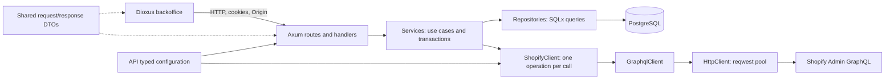
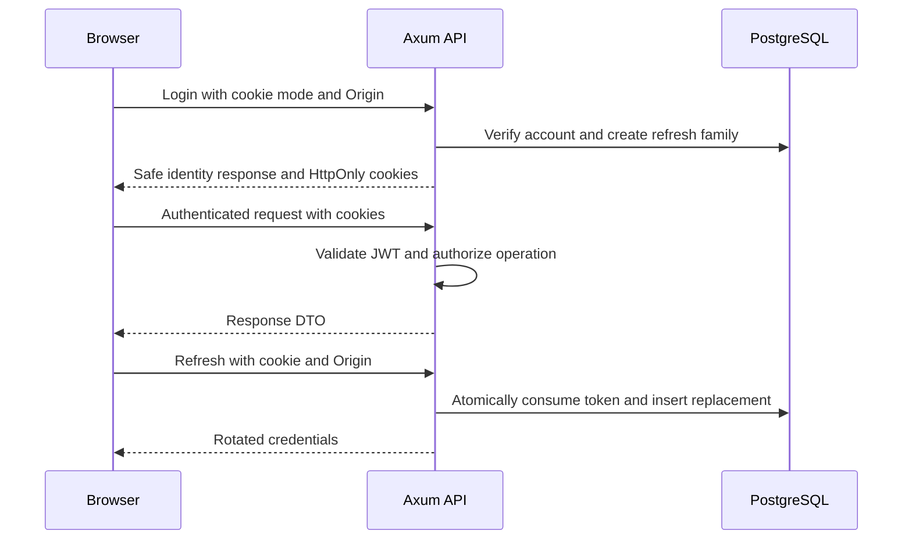
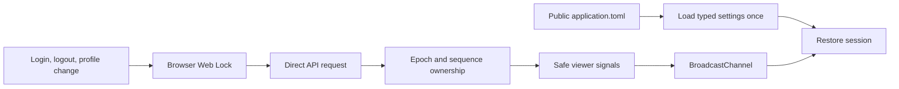

# Service architecture

The application consists of an Axum API, a client-only Dioxus backoffice, shared wire contracts, and a placeholder client UI. [Development and operations](development.md) describes configuration and commands; [verification](verification.md) records measured results and limits.

## Ownership and dependencies

| Package | Responsibility | Boundary |
| --- | --- | --- |
| `services/api` | HTTP endpoints, authentication, authorization, persistence, outbound clients | Database objects, principals, JWT claims, and Shopify wire DTOs remain API-owned |
| `crates/domain` | Shared request/response DTOs and wire enums | No database models, SQLx, JWT claims, or transactions |
| `apps/backoffice` | Browser pages, forms, direct API requests, session coordination | Public configuration only; Axum owns cookies, CORS, and origin checks |
| `apps/client-ui` | Placeholder client application | No implemented service integration |

AppState constructs the optional Shopify client once and shares its HTTP pool. Handlers pass state to report services, which resolve the shared client; optional initialization failures affect report availability without stopping unrelated endpoints.

## Module responsibilities

| API path | Responsibility |
| --- | --- |
| `src/lib.rs` | Module declarations and public re-exports, including `shopify_models` |
| `src/main.rs` | Configuration, database startup, listener, maintenance task, graceful shutdown |
| `src/config.rs` / `src/state.rs` | Typed settings; pool, settings, and signing key in application state |
| `src/routes/` / `src/handlers/` | Route composition; HTTP inputs, responses, and transport |
| `src/middleware/cookies.rs` | Cookie helpers, session transport, origin enforcement |
| `src/middleware/token.rs` | JWT validation and role checks |
| `src/services/` / `src/repositories/` | Use cases and transaction boundaries / SQL queries |
| `src/models/` | Persistence/authentication models and API-owned Shopify contracts |
| `src/validations/` / `src/utils/password.rs` | Input rules / Argon2 operations |
| `src/error.rs` | Public error mapping and centralized boundary logging |
| `src/client.rs` | Generic HTTP/GraphQL request envelopes, decoding, failures, throttling backoff |
| `src/client/shopify.rs` / `src/client/shopify/*.graphql` | Shopify authentication and single-operation proxy methods / matching query documents |
| `src/tests/` | Tests mirroring implementation paths through test-gated child modules |
| `e2e-test/` | Real TCP endpoint tests and shared application/database fixtures |
| `migrations/` / `.sqlx/` | Database migrations / offline SQLx metadata |

| Backoffice path | Responsibility |
| --- | --- |
| `src/lib.rs` / `src/main.rs` | Module declarations / startup and root App |
| `src/config.rs` / `application.toml` | Single typed startup reader / published public settings |
| `src/api.rs` / `src/api/{auth,admins}.rs` | HTTP construction, decoding, errors / endpoint calls |
| `src/session/` | Viewer state, response ownership, browser synchronization |
| `src/route.rs`, `src/pages/`, `src/components/` | Navigation, pages, forms, confirmation, reusable UI |
| `src/tests/` | Configuration, HTTP boundary, and session tests |

## HTTP and authentication

| Concern | Behavior |
| --- | --- |
| Login | Argon2 verification; independent refresh family for each login |
| Access token | JWT validation; 10-minute lifetime and 60-second validation leeway |
| Refresh | Single-use consumption and replacement in one transaction; seven-day refresh lifetime |
| Logout | Revoke the current authenticated account's refresh family |
| Account/password changes | Update and account-wide refresh revocation in one transaction |
| Account deletion | Foreign-key cascade removes refresh credentials |
| Revocation limit | Existing access JWTs remain valid until expiry; no immediate access-token revocation |
| Concurrent issuance | An in-flight login may issue after a concurrent password change; no cross-request global locking |
| Write authorization | Route checks and current actor lookup in services |
| Retention | Startup/hourly cleanup; at most 500 expired/revoked rows per batch with `SKIP LOCKED` |

| Browser transport | Policy |
| --- | --- |
| Cookie mode | `x-session-mode: cookie`; credentialed requests; identity responses exclude token pairs |
| Cookie attributes | HttpOnly, SameSite=Lax, Path=/; secure `__Host-backoffice_auth` in HTTPS mode |
| Local mode | Explicit loopback HTTP permits `backoffice_auth`; UI and API use `localhost` |
| Bearer clients | Token JSON remains supported; an invalid supplied bearer token does not fall back to cookies |
| CORS/origin | Exact configured browser origin; reject missing/null/foreign origins on guarded cookie mutations |
| Caching | Cookie-guarded responses use `Cache-Control: no-store` |

## Browser state and configuration

| Concern | Mechanism |
| --- | --- |
| Startup | Resolve the configuration asset against the current page URL; render pages and call APIs only after loading |
| Failure | Configuration error/Retry view; no configured application calls until recovery |
| Cookie-changing operations | Same-origin Web Locks serialize browser operations |
| Stale responses | Epoch/sequence checks reject results from an earlier account state |
| Other tabs/focus | Broadcast notifications and refresh-based restoration |
| Pagination | Dioxus resources own fetch lifecycle; disable navigation while pending |
| Deployment configuration | Publishing selected local/prod source as one application.toml is planned; selection is not implemented |

## Outbound Shopify operations

| Layer | Contract |
| --- | --- |
| HttpClient / GraphqlClient | Shared HTTP pool; typed transport and GraphQL envelopes; partial-data errors rejected |
| ShopifyClient | One operation per call; root-paged methods accept explicit first/after; no automatic follow-up |
| Initialization | AppState owns one optional client; service resolves availability and retained initialization causes |
| Root report traversal | Inventory forwards caller size/cursor and returns one product page; orders process batches250 until exhausted with cursor progress/cycle checks |
| Nested report data | Product variants and tagged-order lines use fixed first250 without child queries; unexpected hasNextPage fails rather than truncates |
| Models | API-owned source conversions, SKU/stock derivation, exact report arithmetic and merge compatibility; domain DTOs remain wire-only |

| Operation | Result |
| --- | --- |
| ProductsWithVariants | Product connection with bounded variants and location inventory/pricing metadata |
| OrdersByTag | Matching-order connection including bounded report lines |
| OrdersByPayment / SoldVariantsInRange | One matching-order/header page |
| SalesOrderLines | One order envelope with fixed250 lines and completeness metadata; ID-only input |
| Location | Location existence before inventory report queries |
| FindInventoryToActivate | One raw inventory-level page; no eligibility filtering |
| ReplaceOrderTags / ActivateExistingInventory | Raw mutation userErrors and optional output; no automatic inventory mutation |

| Request policy | Guarantee / limit |
| --- | --- |
| Pagination | Inventory preserves upstream page_info without following it; orders exhaust all root pages. Invalid cursor metadata fails |
| Throttling | HttpClient owns one retry loop for HTTP 4xx and data-less all-THROTTLED GraphQL responses; GraphqlClient supplies the envelope classifier |
| Budget | Four total attempts; 1/2/4-second backoff plus 0–250 ms jitter; total retry sleep at most 30 seconds |
| Retry-After | Honor seconds/HTTP-date minimums; stop rather than exceed the sleep budget or overflow duration arithmetic |
| No replay | HTTP 3xx/5xx, network ambiguity/timeouts, decoding errors, partial data, and mutation user errors |
| Mutations | Preserve exact variables and idempotency key during throttling retries; discovery never activates automatically |
| Sales semantics | Callers calculate/filter; current quantities can reflect refunds after the selected order-creation range |
| Platform limits | No snapshot isolation, bulk-export guarantee, or bypass of Shopify limits. Actual query cost remains unverified against the 1,000-point maximum; non-throttle cost errors propagate without retry |
| Compatibility | Discovery retains Shopify's supported deprecated singular inventory-item `variant` field |

## Errors and operational boundaries

| Area | Contract |
| --- | --- |
| API failures | Sanitized public responses; one WARN/ERROR summary at the handling boundary with operation, category, and innermost origin |
| API DEBUG diagnostics | Underlying causes/context are opt-in; conversions do not log |
| Client failures | Shopify entry-point failures carry origin api::client::shopify through ClientError::Origin, retaining typed causes and lower-level transport/decode origins. Generic unwrapped client errors retain their existing origins. One ERROR at AppError response/background handling; no events during creation/conversion/propagation; safe Display/Debug |
| Sensitive fields | Configuration Debug redacts secrets; do not log raw requests, upstream bodies, or client error fields |
| Persistence | Transactions remain service-owned, SQL remains repository-owned; intentional admin/seed migrations are preserved |
| Runtime | Standalone Axum listener and Tokio maintenance; no serverless adapter or production deployment mechanism |
| Capacity | Default database pool has one connection; throughput and deployment guarantees require separate evidence |

## Inventory and order reports

| Concern | Behavior |
| --- | --- |
| Routes | GET /v1/inventories/{inventory_id} and GET /v1/orders/report?tags=TAG; existing ADMIN/SUPER_ADMIN bearer or cookie protection |
| Contract | Domain product report DTOs only; API owns Shopify models, validation and report orchestration |
| Inventory | Numeric location ID; active products and active inventory levels at the location; on_hand includes zero/negative quantities; missing location is 404 |
| Metadata | Category = productType; collection = SKU characters 4–9 inclusive, null for short/missing SKU; cost and weight are current inventory metadata |
| Orders | Literal tag; original quantities and original unit shop-money prices; merge SKU + price + currency with compatible cost/weight/category; missing SKUs stay separate |
| Completeness | Inventory returns one root product page; orders return one response after every matching order page is processed. Bounded nested connections must be complete |
| Precision | API checked decimal arithmetic; domain JSON numbers preserve decimal precision; overflow/invalid upstream numbers fail the whole report |
| Failures | 400 invalid input, 401 authentication, 404 location absent, 503 missing configuration, 502 upstream failure, 504 upstream timeout; sanitized responses |
| Inventory input/output | Location ID path; page_size defaults50 (1–250), cursor forwards unchanged; products plus page_info; filtered empty pages retain continuation |
| Order input/output | Required literal tags value; products only; page_size/cursor rejected400. Former /v1/products endpoint removed |
| Aggregation | Order report merges compatible rows across all matching order pages, in first-seen order; no snapshot isolation |

The nested250 bound is the agreed store workload, not a Shopify platform maximum. Exact live requested query cost remains unverified.
