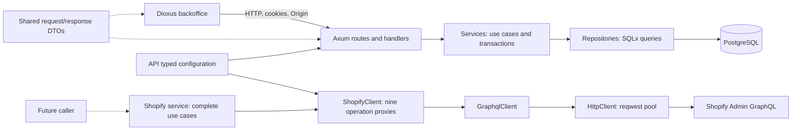
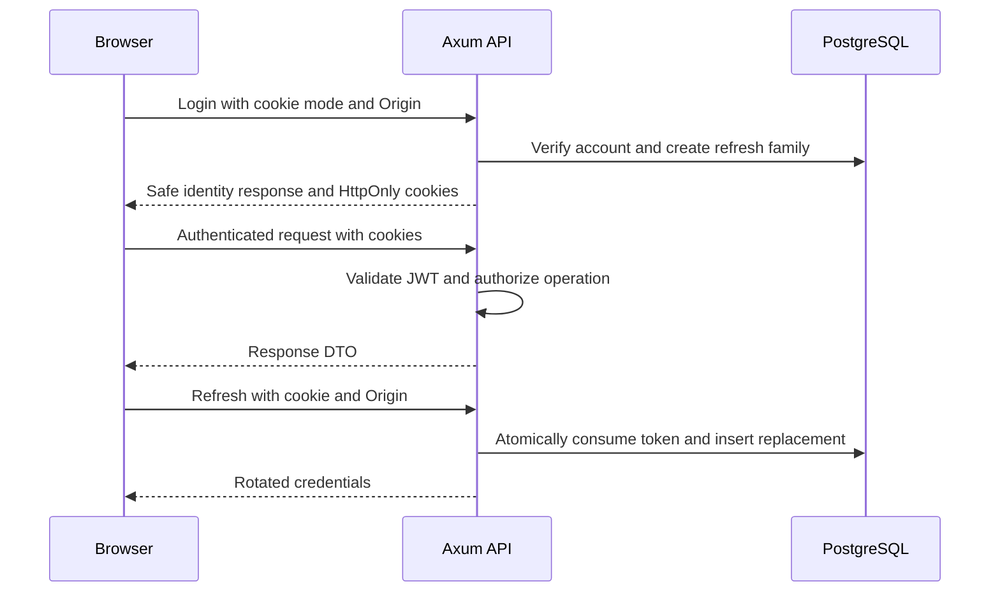
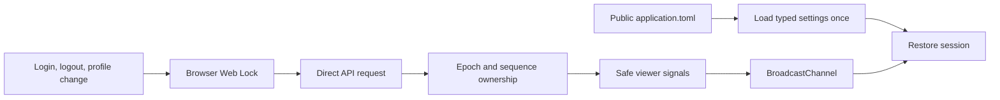

# Service architecture

The application consists of an Axum API, a client-only Dioxus backoffice, shared wire contracts, and a placeholder client UI. [Development and operations](development.md) describes configuration and commands; [verification](verification.md) records measured results and limits.

## Ownership and dependencies

| Package | Responsibility | Boundary |
| --- | --- | --- |
| `services/api` | HTTP endpoints, authentication, authorization, persistence, outbound clients | Database objects, principals, JWT claims, and Shopify wire DTOs remain API-owned |
| `crates/domain` | Shared request/response DTOs and wire enums | No database models, SQLx, JWT claims, or transactions |
| `apps/backoffice` | Browser pages, forms, direct API requests, session coordination | Public configuration only; Axum owns cookies, CORS, and origin checks |
| `apps/client-ui` | Placeholder client application | No implemented service integration |

Callers explicitly construct ShopifyClient from state.settings.client.shopify. Complete use cases are exported as api::shopify_service. Routes, startup, scheduled jobs and persistence do not invoke Shopify.

## Module responsibilities

| API path | Responsibility |
| --- | --- |
| `src/lib.rs` | Module declarations and public re-exports, including `shopify_models` |
| `src/main.rs` | Configuration, database startup, listener, maintenance task, graceful shutdown |
| `src/config.rs` / `src/state.rs` | Typed settings; pool, settings, and signing key in application state |
| `src/routes/` / `src/handlers/` | Route composition; HTTP inputs, responses, and transport |
| `src/middleware/cookies.rs` | Cookie helpers, session transport, origin enforcement |
| `src/middleware/token.rs` | JWT validation and role checks |
| `src/services/` / `src/repositories/` | Use cases and transaction boundaries / SQL queries |
| `src/models/` | Persistence/authentication models and API-owned Shopify contracts |
| `src/validations/` / `src/utils/password.rs` | Input rules / Argon2 operations |
| `src/error.rs` | Public error mapping and centralized boundary logging |
| `src/client.rs` | Generic HTTP/GraphQL request envelopes, decoding, failures, throttling backoff |
| `src/client/shopify.rs` / `src/client/shopify/*.graphql` | Shopify authentication and nine single-operation GraphQL proxies / matching query documents |
| `src/services/shopify.rs` | Seven complete Shopify workflows: pagination, order assembly, inventory selection and mutation interpretation |
| `src/tests/` | Tests mirroring implementation paths through test-gated child modules |
| `e2e-test/` | Real TCP endpoint tests and shared application/database fixtures |
| `migrations/` / `.sqlx/` | Database migrations / offline SQLx metadata |

| Backoffice path | Responsibility |
| --- | --- |
| `src/lib.rs` / `src/main.rs` | Module declarations / startup and root App |
| `src/config.rs` / `application.toml` | Single typed startup reader / published public settings |
| `src/api.rs` / `src/api/{auth,admins}.rs` | HTTP construction, decoding, errors / endpoint calls |
| `src/session/` | Viewer state, response ownership, browser synchronization |
| `src/route.rs`, `src/pages/`, `src/components/` | Navigation, pages, forms, confirmation, reusable UI |
| `src/tests/` | Configuration, HTTP boundary, and session tests |

## HTTP and authentication

| Concern | Behavior |
| --- | --- |
| Login | Argon2 verification; independent refresh family for each login |
| Access token | JWT validation; 10-minute lifetime and 60-second validation leeway |
| Refresh | Single-use consumption and replacement in one transaction; seven-day refresh lifetime |
| Logout | Revoke the current authenticated account's refresh family |
| Account/password changes | Update and account-wide refresh revocation in one transaction |
| Account deletion | Foreign-key cascade removes refresh credentials |
| Revocation limit | Existing access JWTs remain valid until expiry; no immediate access-token revocation |
| Concurrent issuance | An in-flight login may issue after a concurrent password change; no cross-request global locking |
| Write authorization | Route checks and current actor lookup in services |
| Retention | Startup/hourly cleanup; at most 500 expired/revoked rows per batch with `SKIP LOCKED` |

| Browser transport | Policy |
| --- | --- |
| Cookie mode | `x-session-mode: cookie`; credentialed requests; identity responses exclude token pairs |
| Cookie attributes | HttpOnly, SameSite=Lax, Path=/; secure `__Host-backoffice_auth` in HTTPS mode |
| Local mode | Explicit loopback HTTP permits `backoffice_auth`; UI and API use `localhost` |
| Bearer clients | Token JSON remains supported; an invalid supplied bearer token does not fall back to cookies |
| CORS/origin | Exact configured browser origin; reject missing/null/foreign origins on guarded cookie mutations |
| Caching | Cookie-guarded responses use `Cache-Control: no-store` |

## Browser state and configuration

| Concern | Mechanism |
| --- | --- |
| Startup | Resolve the configuration asset against the current page URL; render pages and call APIs only after loading |
| Failure | Configuration error/Retry view; no configured application calls until recovery |
| Cookie-changing operations | Same-origin Web Locks serialize browser operations |
| Stale responses | Epoch/sequence checks reject results from an earlier account state |
| Other tabs/focus | Broadcast notifications and refresh-based restoration |
| Pagination | Dioxus resources own fetch lifecycle; disable navigation while pending |
| Deployment configuration | Publishing selected local/prod source as one `application.toml` is planned; selection is not implemented |

## Outbound Shopify operations

| Layer | Contract |
| --- | --- |
| `HttpClient` | Reusable reqwest pool; per-request generic headers; 30-second per-attempt timeout; redirects disabled |
| `GraphqlClient` | Typed variables; raw envelope error classification before successful data decoding; reject partial-data errors |
| `ShopifyClient` | Nine typed single-page proxies, aligned method/document/operation names; token header and HTTP construction in new; trusted configured Admin API URL, version 2026-10 |
| Request types | Own operation validation, resource-kind checks and search/variable construction; the client forwards validated variables for one operation |
| Shopify models | Connection and PageInfo live beside Shopify contracts; the shared collector imports them |
| DTOs | Public through `api::shopify_models`; shop-only money sets retain decimal amounts and currency; nullable references remain nullable; public raw response envelopes retain pageInfo, userErrors and optional results |
| Shopify service | Complete seven use cases in api::shopify_service; owns cursor traversal, parent checks, assembly, inventory selection and mutation interpretation |
| Configuration | `config.rs` reads SHOPIFY_ACCESS_TOKEN after dotenv loading and assigns it once into the configured optional Shopify subtree during settings construction; token deserialization is skipped; `[client.shopify]` in TOML contains only `admin_api_url` |
| Initialization | Shopify credentials are optional for API startup and required when constructing the client |

| Service function (api::shopify_service) | Result |
| --- | --- |
| `list_products` | Status-filtered products containing the first 250 variants per product (no variant cursor or overflow error), SKUs, location-contextual prices/currencies, images, and quantities |
| `orders_by_payment_id` | All matching orders and transaction/contact details using Shopify's payment ID |
| `orders_by_tag` | Newest-first orders matching one literal tag; all order pages and all line-item pages per order, returned tags, and shop-currency prices |
| `sales_in_range` | Every order created in an offset-aware half-open interval; all line-item pages per order; statuses, test flag, quantities, and original prices retained |
| `replace_order_tags` | Replace the complete tag list; empty input clears it |
| `find_inventory_to_activate` | Target-location levels filtered in Rust to tracked, inactive items with positive on-hand stock |
| `activate_inventory` | Activate the supplied inventory item/location with caller idempotency UUID; omit quantity arguments to preserve stored stock |

| Client method / GraphQL filename stem | GraphQL operation | Result boundary |
| --- | --- | --- |
| products_with_variants | ProductsWithVariants | One products page; nested variants first250 |
| orders_by_payment | OrdersByPayment | One matching orders page |
| orders_by_tag | OrdersByTag | One matching order-header page |
| sold_variants_in_range | SoldVariantsInRange | One date-filtered order-header page |
| sales_order_lines | SalesOrderLines | One order's sales-line page, first250 |
| tagged_order_lines | TaggedOrderLines | One order's tag-result line page, first250 |
| replace_order_tags | ReplaceOrderTags | Raw userErrors and optional order |
| find_inventory_to_activate | FindInventoryToActivate | Raw optional location with unfiltered inventory page |
| activate_existing_inventory | ActivateExistingInventory | Raw userErrors and optional inventory level |

Each query proxy accepts an explicit cursor and returns pageInfo without following it. Service functions take a client and request, preserve the assembled result shapes and fail rather than return partial success.

| Request policy | Guarantee / limit |
| --- | --- |
| Pagination | Service uses the shared collector to traverse outer pages at 250 nodes per request and per-order sales/tag line pages at 250. Child requests use stable order IDs, reset cursors for each order and reject missing/mismatched parents. Missing/repeated/cyclic cursors fail. Products retain first:250 variants without a variant cursor; pageInfo exposes possible truncation |
| Throttling | HttpClient owns one retry loop for HTTP 4xx and data-less all-THROTTLED GraphQL responses; GraphqlClient supplies the envelope classifier |
| Budget | Four total attempts; 1/2/4-second backoff plus 0–250 ms jitter; total retry sleep at most 30 seconds |
| Retry-After | Honor seconds/HTTP-date minimums; stop rather than exceed the sleep budget or overflow duration arithmetic |
| No replay | HTTP 3xx/5xx, network ambiguity/timeouts, decoding errors, partial data, and mutation user errors |
| Mutations | Preserve exact variables and idempotency key during throttling retries; discovery never activates automatically |
| Sales semantics | Upstream services calculate/filter; current quantities can reflect refunds after the selected order-creation range |
| Platform limits | No snapshot isolation, bulk-export guarantee, or bypass of Shopify limits. Nested 250-by-250 query cost remains unverified against the 1,000-point maximum; non-throttle cost errors propagate without retry |
| Compatibility | Discovery retains Shopify's supported deprecated singular inventory-item `variant` field |

## Errors and operational boundaries

| Area | Contract |
| --- | --- |
| API failures | Sanitized public responses; one WARN/ERROR summary at the handling boundary with operation, category, and innermost origin |
| API DEBUG diagnostics | Underlying causes/context are opt-in; conversions do not log |
| Client failures | Distinct transport, HTTP, decode, GraphQL, protocol, input, mutation and retry-budget errors; safe Display/Debug; every handled ClientError logs once at ERROR through AppError response or log_background_error; creation/conversion is silent |
| Sensitive fields | Configuration Debug redacts secrets; do not log raw requests, upstream bodies, or client error fields |
| Persistence | Transactions remain service-owned, SQL remains repository-owned; intentional admin/seed migrations are preserved |
| Runtime | Standalone Axum listener and Tokio maintenance; no serverless adapter or production deployment mechanism |
| Capacity | Default database pool has one connection; throughput and deployment guarantees require separate evidence |
