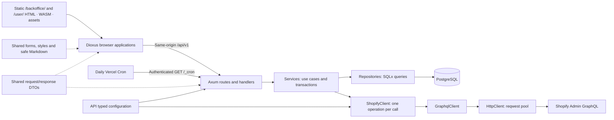
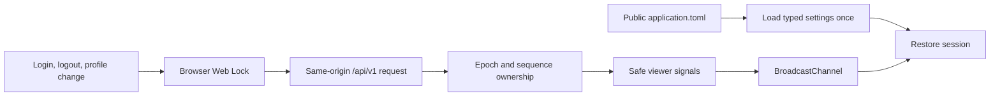
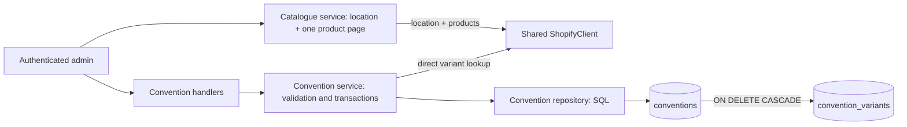
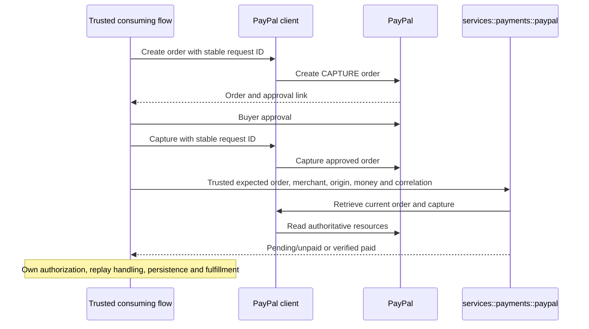

# Service architecture

The application consists of an Axum API, two static Dioxus CSR applications, and shared libraries. Vercel serves the existing applications through two static services and one API container. [Development and operations](development.md) describes configuration and commands; [verification](verification.md) records measured results and limits.

## Ownership and dependencies



| Package | Responsibility | Boundary |
| --- | --- | --- |
| `services/api` | HTTP endpoints, authentication, authorization, persistence, outbound clients | Database objects, principals, JWT claims, and Shopify wire DTOs remain API-owned |
| `crates/domain` | Shared request/response DTOs and wire enums, including `ErrorResponse` and common `PatchField<T>` used by cron and convention PATCH requests | No database models, SQLx, JWT claims, or transactions |
| `crates/ui` | Shared form/error/loading components, CSS and sanitized Markdown preview | No routing, authentication, API calls or persistence |
| `crates/report-generator` | Shared inventory/accounting table projections and CSV serialization for API scheduled reports and backoffice exports | Wire DTO inputs; no provider calls, persistence or browser download transport |
| `apps/backoffice` | CSR browser pages and session coordination; static metadata in `vercel/` | Direct public API calls; API owns cookies and authorization |
| `apps/client-ui` | Existing CSR browser shell; static metadata in `vercel/` | Owns `/user`; browser feature coverage remains limited |

AppState constructs optional outbound clients once and shares their HTTP pools. Handlers resolve shared client availability and pass only concrete dependencies to services; optional initialization failures affect dependent endpoint availability without stopping unrelated endpoints.

## Module responsibilities

| API path | Responsibility |
| --- | --- |
| `src/lib.rs` | Module declarations and public re-exports, including `shopify_models` |
| `src/main.rs` | Application configuration, database startup, listener and graceful shutdown; owns the selected cron implementation and its task lifecycle |
| `src/config.rs` / `src/state.rs` | Typed settings; pool, settings, and signing key in application state |
| `src/routes/` / `src/handlers/` | Route composition; HTTP inputs, responses, and transport |
| `src/handlers/dependencies.rs` | Resolve shared optional clients and preserve availability errors before service calls; accounting requires concrete Stripe, PayPal and Shopify references |
| `src/middleware/cookies.rs` | Cookie helpers, session transport, origin enforcement using BrowserConfig |
| `src/middleware/token.rs` | JWT validation and role checks using the signing key and BrowserConfig |
| `src/services/` / `src/repositories/` | Business use cases and transaction boundaries / SQL queries |
| `services/files.rs` / `services/conventions/logo.rs` | Shared upload orchestration through the injected S3 client / Convention attachment ownership and signed preview projection; payment capability checks remain in the convention service |
| `src/cron.rs` / `src/cron/` | Scheduler loop, dispatch, leases, technical retries, checkpoints and Blob publication; business report/configuration rules stay in services (see [scheduled reports](cron.md)) |
| `src/models/` | Persistence/authentication models and API-owned Shopify contracts |
| `src/validations/` / `src/utils/` | Input rules; upload image/directory and convention logo location validators have no service dependencies / Argon2 operations and native number parsing and multiplication |
| `src/error.rs` | Public and upstream error mapping, retained source diagnostics and centralized boundary logging |
| `src/client.rs` | Generic HTTP/GraphQL request envelopes, decoding, failures, throttling backoff |
| `src/client/shopify.rs` / `src/client/shopify/*.graphql` | Shopify authentication and single-operation proxy methods / matching query documents |
| `src/tests/` | Tests mirroring implementation paths through test-gated child modules |
| `e2e-test/` | Real TCP endpoint tests and shared application/database fixtures |
| `migrations/` / `.sqlx/` | Database migrations / offline SQLx metadata |

| Backoffice path | Responsibility |
| --- | --- |
| `src/lib.rs` / `src/main.rs` | Module declarations / startup and root App |
| `src/config.rs` / `application.toml` | Single typed startup reader / published public settings |
| `src/api.rs` / `src/api/` | HTTP construction, decoding, errors / endpoint calls |
| `src/export.rs` | Shared format/filename API and encoder re-exports |
| `src/export/{csv,xlsx,browser}.rs` | CSV encoding / XLSX encoding and row limits / browser download transport; feature-specific cells/archives remain page-owned |
| `src/pagination.rs` | Shared cursor collection/history for Reports and Orders |
| `src/session/` | Viewer state, response ownership, browser synchronization |
| `src/route.rs`, `src/pages/`, `src/components/` | Route mapping, owning features, confirmations and shared session-scoped draft navigation |
| `src/components/heading.rs`, `src/components/report_table.rs` | Stateless title/back/action layout and accessible rich-row tables; callers own routes, data, requests and feature styling |
| `src/pages/conventions/` | Convention metadata, catalogue selection, exact price drafts and independent logo uploads |
| `crates/ui` | Presentation and safe Markdown shared by backoffice and client UI |
| `src/tests/` | Configuration, HTTP boundary, and session tests |

## HTTP and authentication

| Public Vercel path | API behavior |
| --- | --- |
| `/api/v1` | Existing v1 handlers, bearer/cookie authentication and roles |
| `/api/healthz` | Existing health handler |
| `/_cron` | Authenticated Vercel-only bounded tick |
| Native aliases | `/v1` and `/healthz` remain available on the API listener; no Vercel rewrite |


```mermaid
sequenceDiagram
    participant UI as Browser
    participant API as Axum API
    participant DB as PostgreSQL
    UI->>API: Login with cookie mode and Origin
    API->>DB: Verify account and create refresh family
    API-->>UI: Safe identity response and HttpOnly cookies
    UI->>API: GET /api/v1/auth/session on load or focus
    API->>API: Validate access JWT
    API-->>UI: Safe identity and expiry; no credential changes
    UI->>API: Authenticated request with cookies
    API->>API: Validate JWT and authorize operation
    API-->>UI: Response DTO
    UI->>API: Refresh expired or nearly expired access with cookie and Origin
    API->>DB: Atomically consume token and insert replacement
    API-->>UI: Rotated credentials
```

| Concern | Behavior |
| --- | --- |
| Login | Argon2 verification; independent refresh family for each login |
| Access token | JWT validation; 10-minute lifetime and 60-second validation leeway |
| Session restoration | GET /api/v1/auth/session returns validated access claims without database calls, cookie writes or refresh rotation; renew on 401 or access expiry within three seconds |
| Refresh | Single-use consumption and replacement in one transaction; seven-day refresh lifetime |
| Logout | Revoke the current authenticated account's refresh family |
| Account/password changes | Update and account-wide refresh revocation in one transaction |
| Account deletion | Foreign-key cascade removes refresh credentials |
| Revocation limit | Existing access JWTs remain valid until expiry; no immediate access-token revocation |
| Concurrent issuance | An in-flight login may issue after a concurrent password change; no cross-request global locking |
| Write authorization | Route checks and current actor lookup in services |
| Retention | Hourly VPS task or reserved Vercel invocation time; shared cleanup batches retain `SKIP LOCKED` |

| Browser transport | Policy |
| --- | --- |
| Cookie mode | `x-session-mode: cookie`; credentialed requests; identity responses exclude token pairs |
| Cookie attributes | HttpOnly, SameSite=Lax, Path=/; secure `__Host-backoffice_auth` in HTTPS mode |
| Local mode | Explicit loopback HTTP permits `backoffice_auth`; UI and API use `localhost` |
| Bearer clients | Token JSON remains supported; an invalid supplied bearer token does not fall back to cookies |
| CORS/origin | One exact configured browser allowed-origins list shared with CORS; reject missing/null/foreign origins on guarded cookie mutations |
| Caching | Cookie-guarded responses use `Cache-Control: no-store` |

## Browser state and configuration



| Concern | Mechanism |
| --- | --- |
| Startup | Resolve the configuration asset against the current page URL; render pages and call APIs only after loading |
| Failure | Configuration error/Retry view; no configured application calls until recovery |
| Cookie-changing operations | Same-origin Web Locks serialize browser operations |
| Stale responses | Session epoch/sequence checks reject earlier account state; report/trigger feature ownership keys account ID and role, preserving manual state through same-owner refresh and suppressing stale completions after an owner change |
| Other tabs/focus | Broadcast notifications and read-only session restoration; renew expired or nearly expired access |
| Pagination | Dioxus resources own fetch lifecycle; disable navigation while pending |
| Deployment configuration | Build helper publishes selected local/prod source as one application.toml; restores source configuration after build |

## Outbound Shopify operations

| Layer | Contract |
| --- | --- |
| HttpClient / GraphqlClient | Shared HTTP pool; typed transport and GraphQL envelopes; partial-data errors rejected |
| ShopifyClient | One operation per call; root-paged methods accept explicit first/after; no automatic follow-up |
| Initialization | AppState owns one optional client; handler resolves availability and retained initialization causes |
| Root report traversal | Inventory forwards caller size/cursor and returns one product page; orders process batches250 until exhausted with cursor progress/cycle checks |
| Nested report data | Product variants and tagged-order lines use fixed first250 without child queries; unexpected hasNextPage fails rather than truncates |
| Models | API-owned source conversions, SKU/stock derivation, report row totals and merge compatibility; shared numeric helpers live in utils/numbers.rs; domain DTOs remain wire-only |

| Operation | Result |
| --- | --- |
| ProductsWithVariants | Report product connection with bounded variants and location inventory/pricing metadata |
| CatalogueProducts | One root product page with current product content, exact contextual source price and location `available`; fixed 250 variants, no supplier cost |
| ConventionVariant | One direct variant lookup for product association, product status, tracking, inventory policy and display snapshots; no catalogue scan |
| OrdersByTag | Matching-order connection including bounded report lines |
| OrdersByPayment | One accounting-enrichment order page with actual order tags; retained operation name |
| Location | Location existence before inventory report queries |
| FindInventoryToActivate | One raw inventory-level page; no eligibility filtering |
| ActivateExistingInventory | Raw mutation userErrors and optional output; activation takes item/location IDs and a stable UUID; no quantity arguments |

| Request policy | Guarantee / limit |
| --- | --- |
| Pagination | Inventory preserves upstream page_info without following it; orders exhaust all root pages. Invalid cursor metadata fails |
| Throttling | HttpClient owns one retry loop for HTTP 4xx and data-less all-THROTTLED GraphQL responses; GraphqlClient supplies the envelope classifier |
| Budget | Four total attempts; 1/2/4-second backoff plus 0–250 ms jitter; total retry sleep at most 30 seconds |
| Retry-After | Honor seconds/HTTP-date minimums; stop rather than exceed the sleep budget or overflow duration arithmetic |
| No replay | HTTP 3xx/5xx, network ambiguity/timeouts, decoding errors, partial data, and mutation user errors |
| Mutations | Preserve exact variables and idempotency key during throttling retries; discovery never activates automatically |
| Platform limits | No snapshot isolation, bulk-export guarantee, or bypass of Shopify limits. Actual query cost remains unverified against the 1,000-point maximum; non-throttle cost errors propagate without retry |
| Compatibility | Discovery retains Shopify's supported deprecated singular inventory-item `variant` field |

## Stripe payment provider boundary

| Layer | Responsibility |
| --- | --- |
| Shared Stripe client | One pooled provider operation per call: create/retrieve hosted Checkout Session, retrieve PaymentIntent/current direct account, and existing Charge/accounting reads. Integer minor-unit money; mutation idempotency stays caller-owned |
| Stripe payment models / `services::payments::stripe` | Compare authoritative current Session, PaymentIntent and Charge with trusted caller account/environment/money/correlation expectations; return explicit pending, expired/unpaid or verified paid outcome. No Shopify dependency |
| `client::stripe::webhook` | Authenticate timestamp and exact signed bytes before model decoding. Provider webhook models own envelope/reference/event types and consumed correlation text; checkout notification services only apply account/environment and event-selection rules |
| Consumer boundary | Trusted callers own return destinations, durable operation identities, refund policy, replay handling and stored business state. The provider layer has no persistence or Shopify effects; the durable guest checkout consumer owns its routes and state |

[Stripe operations](development.md#stripe-hosted-checkout) describes privileged caller inputs, direct Postman requests and manual verification limits.

## Errors and operational boundaries

| Area | Contract |
| --- | --- |
| API failures | One shared AppError carries status, public message, optional original cause, automatic creation/conversion location and ordered contexts. Sanitized responses; one WARN/ERROR summary at the handling boundary with operation, HTTP status and origin=file:line:column; propagation preserves the first location |
| API DEBUG diagnostics | Underlying causes/context are opt-in; conversions do not log |
| Client failures | ClientError captures file/line/column automatically and retains typed ClientErrorKind failures and transport/decoder sources. AppError derives optional client_origin from direct/shared/wrapped client causes alongside its own mapping location. One ERROR at response/background handling; no events during creation/conversion/propagation; safe Display/Debug |
| Sensitive fields | Configuration Debug redacts secrets; do not log raw requests, upstream bodies, or client error fields |
| Persistence | Transactions remain service-owned, SQL remains repository-owned; intentional admin/seed migrations are preserved |
| Runtime | Two static services and one API listener; VPS periodic tasks or Vercel authenticated bounded HTTP tick |
| Capacity | Production database pool permits two connections; bounded cron/report capacity requires workload evidence |

## Inventory and order reports

| Concern | Behavior |
| --- | --- |
| Routes | Parent v1 protected route group authenticates /v1/admin once; /v1/customer reserved for future customer routes. GET /v1/admin/inventories/{inventory_id} and GET /v1/admin/orders/report?tags=TAG; existing ADMIN/SUPER_ADMIN bearer or cookie protection |
| Contract | Domain product report DTOs only; API owns Shopify models, validation and report orchestration |
| Service ownership | inventories.rs retrieves one inventory page; orders.rs aggregates orders; handlers/dependencies.rs resolves client availability; error.rs::upstream shares upstream-error mapping |
| Inventory | Numeric location ID; active products and active inventory levels at the location; on_hand includes zero/negative quantities; missing location is 404 |
| Metadata | Category = productType; collection = SKU characters 4–9 inclusive, null for short/missing SKU; cost and weight are current inventory metadata |
| Orders | Literal tag; original quantities and original unit shop-money prices; merge SKU + price + currency with compatible cost/weight/category; missing SKUs stay separate |
| Completeness | Inventory returns one root product page; orders return one response after every matching order page is processed. Bounded nested connections must be complete |
| Precision | Native f64 arithmetic with calculated totals rounded to two decimal places; invalid/non-finite values fail the whole report; integer quantity addition remains checked |
| Failures | 400 invalid input, 401 authentication, 404 location absent, 503 missing configuration, 502 upstream failure, 504 upstream timeout; sanitized responses |
| Inventory input/output | Location ID path; page_size defaults50 (1–250), cursor forwards unchanged; products plus page_info; filtered empty pages retain continuation |
| Order input/output | Required comma-separated tags; every tag must match (AND); products only; page_size/cursor rejected400. |
| Aggregation | Order report merges compatible rows across all matching order pages, in first-seen order; no snapshot isolation |

The nested250 bound is the agreed store workload, not a Shopify platform maximum. Exact live requested query cost remains unverified.

## Convention configuration and selection catalogue

These operations use the existing ADMIN/SUPER_ADMIN protected group and browser cookie/origin rules. Paths below use `/api/v1/admin`; native `/v1/admin` aliases expose the same handlers.

| Method and suffix | Contract |
| --- | --- |
| `GET /conventions` | Page/per-page list with optional `preorder_enabled` filter |
| `GET /conventions/options` | Supported currency/payment choices derived from intrinsic precision and provider policy |
| `POST /files` | Upload a bounded PNG/JPEG to a requested convention slug folder; return a versioned object location and short-lived signed preview |
| `POST /conventions` | Create immutable slug/currency, metadata/payment methods and an optional validated logo location; server sets `preorder_enabled=false` |
| `GET /conventions/{id}` | Read one UUID-identified convention |
| `PATCH /conventions/{id}` | Patch metadata, logo location, methods or manual enable flag; slug/currency are not writable |
| `DELETE /conventions/{id}` | Delete convention and cascade its current variant memberships |
| `GET /conventions/{id}/variants` | Page/per-page current selections with exact `final_price` strings and persisted product/variant titles, SKU and representative images |
| `PUT /conventions/{id}/variants` | Atomically replace all selections, at most 250 unique Shopify variant IDs |
| `GET /conventions/catalogue` | One Shopify product page for a required positive numeric location ID (resolved to a Shopify Location GID by the backend), active-product search guard and root cursor; return tracked variants with active inventory levels at the requested location |



| Ownership / state | Current behavior |
| --- | --- |
| Shared DTOs | `domain::dto::conventions` owns wire contracts; `dto::common::PatchField` preserves missing/null/value semantics and the root `domain::dto::PatchField` export; cron uses the same type |
| API persistence | `TIMESTAMPTZ` timestamps decode and serialize in UTC; event dates remain calendar dates. `conventions` stores UUID, unique slug, name/logo location, country, event dates, description Markdown, manual enable flag, currency, payment methods and timestamps. `convention_variants` stores UUID, parent, Shopify product/variant GIDs, positive finite `NUMERIC` final price, nullable product/variant title, SKU, representative image URLs and DENY/CONTINUE inventory-policy snapshots, and timestamps; parent+variant is unique |
| Migration | The published convention CREATE migration is preserved byte-for-byte. Its existing `logo_url` column stores S3 object locations; legacy HTTPS values remain stored and do not produce signed previews. No additional logo column or migration is required |
| Country validation | API-owned CountryCode uses the existing assigned ISO alpha-2 set for create/PATCH, normalizes ASCII case and preserves string request/storage fields |
| Immutable identity | API excludes slug/currency from PATCH; a database trigger also rejects changes. One convention has one user-supplied currency stored in the database; no currency allowlist configuration |
| Price representation | Major-unit decimal strings such as `"12.99"` pass through exact decimal validation and PostgreSQL `NUMERIC`, without floating point. Responses use currency precision; positive amounts must fit signed 64-bit minor units and selected payment-method precision |
| Writes | Services own transactions and parent-row locks; repositories own SQL. Shopify validation precedes the transaction; changed selection/payment assumptions are rechecked under the lock and conflicting validation returns 409 |
| Eligibility validation | New/changed selections use direct Shopify variant reads; every selection is revalidated while enabled and when enabling. Product must exist, match the submitted product, be ACTIVE, track inventory; DENY and CONTINUE are accepted. This does not reserve or check location stock |
| Manual enablement | Enabling requires nonempty eligible selections and supported currency/methods/prices; clearing an enabled convention is rejected until disabled. Event dates are metadata, without scheduling, lifecycle, version, readiness or display-order fields |
| Display snapshots | Existing Shopify validation returns trusted product/variant titles, nullable SKU, product featured image URL, variant image URL and inventory policy. Saved images expose URLs only. Required saves write price and snapshot atomically; explicit nulls clear old metadata. Unchanged disabled saves retain the latest locked row snapshot and timestamps. GET uses PostgreSQL only, including during provider failure; rows with missing display data or policy remain nullable until required validation, without automatic backfill |
| Router composition | Admin nests the relative convention child router under `/conventions`; canonical collection URL stays slashless with no trailing-slash redirect; outer `/v1` alias and middleware remain shared |
| Public consumers | Public catalogue and quote services enforce manual enablement; customer routing and carts consume those APIs. Guest checkout stores linkage and evidence hashes; Shopify retains the accepted draft purchase independently of current convention membership |

| Catalogue contract | Behavior |
| --- | --- |
| Content | Current Shopify product title/description/image, variant title/SKU/image/options and inventory-item ID; no invented variant description or supplier cost |
| Source price | Exact current contextual Shopify amount string and currency; distinct from persisted convention final prices |
| Available quantity | Requested location `available` integer; active zero/negative values remain numbers and zero remains eligible. Missing/inactive levels and untracked variants are omitted; DENY and CONTINUE variants with active location inventory remain visible. Returned variants have eligible=true |
| Search / paging | The service supplies `status:active AND tracks_inventory:true`, grouping optional raw search as `status:active AND tracks_inventory:true AND (<search>)`; products with no eligible tracked variants are omitted. One root page with opaque cursor and unchanged upstream metadata, including empty filtered pages; variants fixed `first:250`, without child paging. Any nested overflow or incomplete provider page fails safely with 502 |
| Failure / inventory boundary | Missing location 404; unavailable client 503; upstream 502/timeout 504. Catalogue reads do not change stock. Existing inventory/report `on_hand`, filtering, supplier-cost and numeric-total semantics remain unchanged |

## Inventory enablement

| Owner | Responsibility |
| --- | --- |
| POST /v1/admin/inventories/{inventory_id}/enable | Existing admin authentication and cookie origin checks; numeric location validation; no query parameters or body |
| Inventory enable service | Receive the concrete shared client resolved by handlers/dependencies.rs; use services/pagination for complete traversal before writing; retain item deduplication and eligibility in the service |
| Shopify inventory models | Eligibility: tracked, inactive, positive on_hand; validate required quantities and item/product IDs |
| Shared Shopify client | One GraphQL operation per call; activate each variant inventory item using item/location IDs and stable retry UUID, without quantity arguments |
| Outcome DTO | Per-item total/success/failed and optional errors with numeric product_id; partial mutation failures continue; discovery failures return ordinary API errors before writes |
| Consistency limit | No upstream snapshot or rollback; timeouts can leave activation outcome unconfirmed. No quantity arguments are sent; live provider defaults are unverified |


## Order fulfillment ownership

| Responsibility | Owner / contract |
| --- | --- |
| Order listing / reports | `services/orders.rs`; listing tags optional, report tags required; listing returns nullable customer-profile full name, order contact email and shipping address country code |
| Labels | `services/orders/shipping_label.rs` orchestrates reads and tag transitions; focused carrier children build payloads; `Courier` selects carriers and tag spelling |
| Fulfillment | Combined FulfillmentOrders query with fixed250 item nodes and root fulfillment-order pagination; one selling location and at most 250 order items; skip completed/cancelled fulfillment orders and zero-remaining lines, create once for all eligible entries, then remove SHIPPING |
| Reship | Four-digit merchant number uses one shared ListOrders name search (first1, conditional email); send email before adding RETURNED; return accepted `email_id` after tagging |
| Provider operations | Shopify operation methods in `client/shopify.rs`; one EditOrderTags document selects additive/removal semantics; shared Resend client owns send timeout |
| Pagination | One `for_each_page` traversal supports fetched or prefetched initial connections; services own multi-call orchestration |
| Configuration / templates | Private sender profile from central environment overrides, non-sensitive provider timeouts in TOML; static HTML in `services/api/assets/` |
| Public metadata | One domain `dto/pagination::PageInfo`; inventory, orders and provider models consume it directly; public JSON remains snake_case and provider connections retain camelCase serialization |
| Order workflow bound | ShippingOrders selects items and shipping methods together, each fixed at first250 with nodes-only models; root order pages remain paginated. No separate nested continuation queries |
| Reship partial effects | Send failure stops before tagging; tag failure can follow accepted email. No automatic email retry or compensation; success means provider acceptance and successful tagging |
| Tag edits | Shared order service reuses ListOrders (id filter, id/tags projection) before tagsAdd/tagsRemove; ASCII-case-insensitive workflow matching, stored spelling for removal, skip existing additions and no-op mutations; unrelated tags preserved |
| Shopify projections | Fulfillment, shipping and reship DTOs live in models/shopify.rs alongside the existing provider models; fulfillment retains ShopifyId through validation, service and the fulfillment-order client call |
| Mock declaration | Sum non-Tip item prices once, multiply by5, minimum100, independent of currency; stock items contribute price but not quantity; no price×quantity multiplication |

## Convention administration

[Convention administration and logo storage](conventions.md) describes saved and draft state, catalogue selection and persistent S3 logo locations and short-lived signed preview access.

## PayPal payment provider boundary

| Layer | Responsibility |
| --- | --- |
| Shared PayPal client | One provider operation per call: create/get/capture Orders v2, get capture and verify webhook signature. Reuse pooled HTTP, OAuth caching and bounded transport retry behavior; create/capture request IDs stay caller-owned |
| PayPal payment models / `services::payments::paypal` | `verify_payment` compares authoritative current order/capture evidence with trusted order ID, merchant, configured API origin, purchase-unit reference/custom correlation and positive integer minor-unit money. Return explicit pending/approved-unpaid, terminal-unpaid or verified-paid outcome |
| Evidence | Require one intended purchase unit, a completed order and one linked final completed capture, independently retrieved with the same ID. Exact money/merchant/correlation and consistent optional identity fields are required; unknown, inconsistent, refunded or reversed evidence fails closed |
| Currency precision | Reuse `CurrencyCode` variants with exact canonical input spelling. Preserve the supported zero/two-decimal currency set; unsupported, unknown and noncanonical codes fail verification |
| Client errors | Invalid trusted expectations return `ClientErrorKind::InvalidInput`; inconsistent provider evidence returns `Protocol`. Upstream client failures retain their kind, source and original location. The checkout application service owns HTTP mapping and provider-independent orchestration |
| Authenticated events | Validate transmission headers and full envelope, require successful PayPal verification postback, then expose typed event kind and related order ID. Incoming event IDs and capture/order contradictions are validated without forwarding unused event/capture IDs. Authentication/event type does not establish payment success; event and polling consumers use current-resource verification |
| Consumer boundary | Trusted callers own authorization, return destinations, durable create/capture IDs, retention-aware ambiguous-write recovery, replay handling and stored business state. The provider layer remains independent of the durable guest checkout routes, ledger and Shopify completion |
| Configuration | Optional shared client uses TOML API origin/timeout and environment-supplied credentials. QA selects the Sandbox REST origin. Trusted expectations come from the checkout/draft owner, never browser/event/provider-copied totals |
| Shopify consumer | Stateless draft completion below reuses this verifier. The consuming flow binds payment to draft and owns authorization, persistence, serialization and uncertain-outcome recovery; the PayPal provider boundary remains read-only |

Buyer approval alone does not collect a PayPal wallet payment. The caller explicitly captures an approved order with its stable request ID; verification remains read-only. [PayPal operations](development.md#paypal-orders) records caller inputs and manual verification limits.




## Externally paid Shopify draft completion

| Owner | Contract |
| --- | --- |
| Trusted consuming flow | Supply the actual DraftOrder ID and independently trusted Stripe/PayPal expected payment context. Own authorization, payment-to-draft association, durable operation identity, cross-request serialization, polling and webhook dispatch |
| `services/checkout_completion.rs` | Invoke the existing provider verifier, compare exact draft presentment money, then read/complete the draft and reconcile verified payment-reference tags on the real linked order |
| Shopify client | Single-operation draft/order reads, one-shot draft completion and additive order tag edits; preserve unrelated tags and confirm requested references by order readback |
| Completion modes | `CompleteIfOpen` permits completing an eligible open draft. `ReconcileOnly` only reads/reconciles; after an uncertain completion the caller must retain uncertainty and use this mode |
| Completion evidence | Verified provider payment, matching real draft/order identity and money, paid/not-cancelled order and confirmed owned tags. Stripe refund/dispute evidence prevents completion without changing the provider verifier's original-payment semantics |
| Retry boundary | Replays read Shopify truth. A linked completed order permits tag reconciliation without another completion. The completion library itself has no ledger or process-local cache; guest checkout supplies durable state. No exactly-once guarantee |
| Native confirmation | Shopify draft completion remains the confirmation-email mechanism; controlled fixtures do not prove merchant email delivery |
| Accounting | Existing provider collection and Shopify matching copy actual order tags to transaction DTOs and CSV. No local mappings, saved-order fallback, extra Charge/account lookup or cron change |

```mermaid
sequenceDiagram
    participant Caller as Trusted consuming flow
    participant Service as Draft completion
    participant Provider as Existing payment verifier
    participant Shopify as Shopify client
    Caller->>Service: Draft ID, expected payment, completion mode
    Service->>Provider: Verify current authoritative payment
    Provider-->>Service: Pending/unpaid or verified evidence
    Service->>Shopify: Read draft and linked order
    opt Verified eligible open draft and CompleteIfOpen
        Service->>Shopify: Complete draft once
    end
    Service->>Shopify: Read real paid order, add missing owned tags
    Service->>Shopify: Confirm order and tag readback
    Service-->>Caller: Outcome or reconciliation required
    Note over Caller: Retain uncertain outcome; retry with ReconcileOnly
```


## Guest checkout orchestration

The public `/v1/order` routes (also `/api/v1/order`) combine the existing provider clients and stateless Shopify completion service. The customer cart initiates hosted payment; standalone return/cancel pages verify the original attempt without requiring the catalogue.

```mermaid
sequenceDiagram
    participant Browser
    participant API as Checkout API
    participant DB as PostgreSQL
    participant Shopify
    participant Gateway as Stripe or PayPal
    Browser->>Browser: Save random operation UUID and guest secret per attempt
    Browser->>API: POST /order/checkout with guest bearer and purchase intent
    API->>DB: Save ownership, purchase evidence hash and mutation intent
    API->>Shopify: Create draft and reserve inventory
    API->>DB: Save confirmed draft and reservation deadline
    API->>Gateway: Create payment from verified draft money and stable key
    API-->>Browser: Checkout ID, status, money, deadline and redirect action
    Browser->>Gateway: Follow hosted payment or wallet approval URL
    Gateway-->>Browser: Return to configured frontend path with checkout ID
    Browser->>API: POST /order/{checkout_id}/verify; same guest bearer, empty body
    opt PayPal approved but unpaid
        API->>Gateway: Capture with stable derived request ID
    end
    API->>Gateway: Independently verify current payment and exact money
    API->>Shopify: Complete eligible draft; read back paid order and tags
    API->>DB: Save payment, completion and order state
    API-->>Browser: Completed with order, processing, unpaid or reconciliation required
    Gateway->>API: POST /order/webhook/{provider} with provider authentication
    API->>DB: Authenticate association; claim same advancement path
    Note over API,DB: Browser return and webhook are independent; neither proves paid
```

| Endpoint / owner | Data and behavior |
| --- | --- |
| `POST /order/checkout` | Random v4 `operation_id` (also checkout ID), convention UUID, email, selected provider, public Shopify ProductVariant GIDs or legacy selection UUIDs, quantities, expected positive minor-unit prices and uppercase currency. Resolve selected membership and reject duplicate resolved variants, including mixed identifiers. Revalidate current convention, prices, eligibility and Shopify inventory. Checkout requires tracked inventory, DENY policy and sufficient available quantity at its configured location; catalogue browsing accepts both policies. Submitted prices are comparison guards; changed price requires refreshed consent |
| `POST /order/{checkout_id}/verify` | Same guest bearer, empty body, no query. Hydrate the accepted Shopify draft/provider bindings; no email or cart restoration response. Recover by the ID saved before sending when authoritative resources exist; pre-draft recovery has the boundary below |
| `POST /order/webhook/{provider}` | Exact event bytes and Stripe signature or PayPal transmission headers; no admin JWT or Origin. Authenticate before association. Unsupported authenticated events are acknowledged without requiring Shopify; supported events use current provider truth and the checkout state/claim rather than a stored event receipt. Unfinished/busy advancement remains retryable |
| Shared advancement | Database claim token serializes and fences state updates; persist external-write intent before upstream calls. Same guest and unchanged create payload resume one attempt; changed payload conflicts. Uncertain draft creation/completion requires reconciliation rather than blind replacement writes |
| Payment / reservation | Draft reservation precedes payment creation; accepted draft evidence commits to email, variants/quantities and exact total/currency. Fresh reads must match this commitment and the required tag subset. Stripe create/recovery POSTs pin `2026-08-26.dahlia`; accounting reads keep their existing version behavior. A complete/unpaid Stripe Session with no URL stays processing. PayPal pickup requests use typed `NO_SHIPPING`; approval remains unpaid until capture |
| Reservation expiry | Verify known provider truth before deciding mutation eligibility. A missing/shortened/expired hold does not establish unpaid status. Reconcile an already-linked paid Shopify order after expiry; block new capture/completion when reservation safety is unavailable. No automatic refund or stock oversell |
| Completion | Existing completion service verifies provider truth and Shopify money/order/tag readback. Payment alone is not completed checkout. Replays read the real linked order; only completed returns its actual ID/name. Native Shopify completion remains the confirmation-email mechanism |

| Location | Retained information |
| --- | --- |
| Browser cart storage | Convention/variant IDs, quantities and displayed price/currency for shopping convenience; always revalidated. Cart identity is distinct from a payment operation ID; keep cart separate from payment attempts |
| Browser per-attempt `localStorage` | Before first request: cryptographically random v4 UUID and independent random 32-byte secret encoded as 64 hex characters; convention slug, provider, cart snapshot and recovery state. A Web Lock owns initiation before identity generation and storage. Send secret only in guest Bearer header; URL contains only checkout ID. Reloads, gateway navigation and tabs recover the same attempt. Local status is not payment authority |
| Browser `sessionStorage` | Exact original create body, including confirmation email, for identical same-attempt replay. Removed on completed/unpaid/rejected/expired disposition. No email in normal cart or localStorage; no provider secret or card data. Lost guest storage prevents guest access; ID alone cannot restore PII |
| `checkouts` | SHA-256 hash of decoded guest-secret bytes, recovery expiry, fingerprint, convention linkage, trusted provider account/environment, draft/payment/order references, accepted-draft and required-tag hashes, frozen success/cancel URLs until gateway binding, gateway request fingerprint, reservation deadline, independent payment/draft/completion states and fenced claim. Create/capture keys derive from checkout ID; email/items/totals/redirect/order-name are not cached locally |
| Shopify draft / order | Authoritative email, items and exact presentment money; confirmed reservation and real completion. Required checkout/convention tags bind identity; unrelated added tags remain accepted |
| Gateway resources | Current redirect/approval URL and verified payment evidence. No local item, event-receipt or source-admission tables; removal of the SQL admission counter removes that checkout-only throttle |

Guest credentials are distinct from backoffice JWT/cookies. Recovery expiry limits browser authorization; callbacks can finish independently. Same-origin scripts can read localStorage, so frontend script integrity remains a capability boundary. The UI permits a new attempt only after authoritative unpaid status or a known pre-payment rejection; ambiguous errors preserve the existing attempt. Verified completion clears only an unchanged matching cart snapshot. Actual browser/provider verification limits belong in [verification](verification.md).

| Customer status | Presentation / action |
| --- | --- |
| `requires_action` | Continue the same payment through its validated hosted redirect |
| `processing` | At most 12 checks five seconds apart, then manual status check; do not pay again |
| `unpaid` | Preserve cart and allow returning to it for a new attempt |
| `reconciliation_required` | Keep receipt and contact the shop; do not pay again |
| `completed` | Congratulations, real Shopify display name verbatim, and instructions to check/show the confirmation email at the convention |

Automatic checkout recovery is the separate ENZ-49 follow-up. This change advances through create, customer verify and authenticated webhooks; it does not add a cron worker, retry migration or scheduler changes.


| Recovery boundary | Required behavior |
| --- | --- |
| No draft attempted | Only the unchanged original create body can resume creation. ID + secret cannot reconstruct an email or selection that never reached Shopify |
| Draft mutation attempted, ID missing | Paginate Shopify drafts filtered by checkout tag; inspect exact tag and accepted evidence. Bind one unique match. Zero/multiple/incomplete results require reconciliation; never create a replacement draft from search absence |
| Gateway create ambiguous | Rebuild from verified draft money, pinned account/environment, stored URLs and fixed reservation deadline. Require the original request fingerprint and derived idempotency key; mismatch stops instead of opening another payment |
| Authoritative money unavailable | Return safe 409/503 for domain/busy cases or sanitized upstream failure, preserving the existing required-money DTO. Never manufacture zero totals |

### Reading the checkout flow

| Path | Named code sequence | Durable boundary / uncertain response |
| --- | --- | --- |
| Stripe | [create/verify](../services/api/src/services/checkout.rs) → [purchase reserve/read](../services/api/src/services/checkout/purchase.rs) → [start or reconcile payment](../services/api/src/services/checkout/provider.rs) → [account, Session, Intent, Charge verification](../services/api/src/services/payments/stripe.rs) → [paid draft completion](../services/api/src/services/checkout_completion.rs) | Creating and original request fingerprint precede Session creation. Paid state precedes eligible Shopify completion; refunded/disputed evidence stops completion |
| PayPal | Same purchase steps → [payment reconciliation](../services/api/src/services/checkout/provider.rs) → [order/capture verification](../services/api/src/services/payments/paypal.rs) → paid draft completion | Approval remains unpaid. Processing and stable capture key precede capture; independently retrieved capture must match before paid state |
| Lost draft/create response | [purchase recover](../services/api/src/services/checkout/purchase.rs) searches exact checkout tag and validates purchase/reservation evidence | Creating was saved before the call. Exactly one matching draft is required; zero/ambiguous matches cannot create a replacement |
| Lost completion response | [provider complete](../services/api/src/services/checkout/provider.rs) and [completion service](../services/api/src/services/checkout_completion.rs) | Completing is saved by the existing callback immediately before the actual mutation. Uncertain attempts use ReconcileOnly and linked-order readback; they do not repeat completion blindly |
| Webhook | [handler authentication](../services/api/src/handlers/checkout.rs) → [typed notification selection](../services/api/src/services/checkout/notification.rs) → same fenced advancement | Authenticity selects a checkout; current provider evidence establishes payment. Irrelevant authenticated events acknowledge before Shopify dependencies |

The coordinator retains the existing claim/release and recovery machinery. The table is a source map; final review traces the actual code and its state/effect order. Services receive concrete dependencies, while handlers resolve checkout configuration and client references directly from AppState.

The evidence projection verifies email, total/currency, variant/quantity pairs and required tags. It does not claim separate line-price, tax or shipping verification. Reservation deadlines are checked separately at database microsecond precision.
