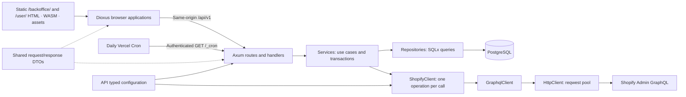
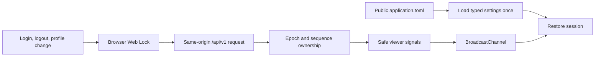
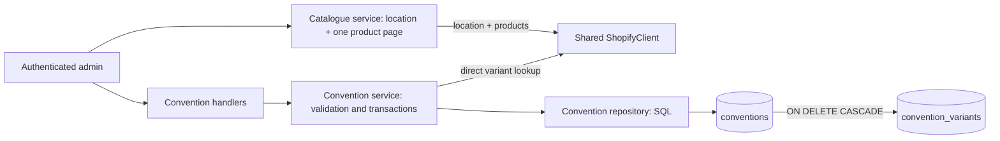

# Service architecture

The application consists of an Axum API, two static Dioxus CSR applications, and shared libraries. Vercel serves the existing applications through two static services and one API container. [Development and operations](development.md) describes configuration and commands; [verification](verification.md) records measured results and limits.

## Ownership and dependencies



| Package | Responsibility | Boundary |
| --- | --- | --- |
| `services/api` | HTTP endpoints, authentication, authorization, persistence, outbound clients | Database objects, principals, JWT claims, and Shopify wire DTOs remain API-owned |
| `crates/domain` | Shared request/response DTOs and wire enums, including `ErrorResponse` and common `PatchField<T>` used by cron and convention PATCH requests | No database models, SQLx, JWT claims, or transactions |
| `crates/report-generator` | Shared inventory/accounting table projections and CSV serialization for API scheduled reports and backoffice exports | Wire DTO inputs; no provider calls, persistence or browser download transport |
| `apps/backoffice` | CSR browser pages and session coordination; static metadata in `vercel/` | Direct public API calls; API owns cookies and authorization |
| `apps/client-ui` | Existing CSR browser shell; static metadata in `vercel/` | Owns `/user`; browser feature coverage remains limited |

AppState constructs optional outbound clients once and shares their HTTP pools. Handlers resolve shared client availability and pass only concrete dependencies to services; optional initialization failures affect dependent endpoint availability without stopping unrelated endpoints.

## Module responsibilities

| API path | Responsibility |
| --- | --- |
| `src/lib.rs` | Module declarations and public re-exports, including `shopify_models` |
| `src/main.rs` | Application configuration, database startup, listener and graceful shutdown; owns the selected cron implementation and its task lifecycle |
| `src/config.rs` / `src/state.rs` | Typed settings; pool, settings, and signing key in application state |
| `src/routes/` / `src/handlers/` | Route composition; HTTP inputs, responses, and transport |
| `src/handlers/dependencies.rs` | Resolve shared optional clients and preserve availability errors before service calls; accounting requires concrete Stripe, PayPal and Shopify references |
| `src/middleware/cookies.rs` | Cookie helpers, session transport, origin enforcement using BrowserConfig |
| `src/middleware/token.rs` | JWT validation and role checks using the signing key and BrowserConfig |
| `src/services/` / `src/repositories/` | Business use cases and transaction boundaries / SQL queries |
| `src/cron.rs` / `src/cron/` | Scheduler loop, dispatch, leases, technical retries, checkpoints and Blob publication; business report/configuration rules stay in services (see [scheduled reports](cron.md)) |
| `src/models/` | Persistence/authentication models and API-owned Shopify contracts |
| `src/validations/` / `src/utils/` | Input rules / Argon2 operations and native number parsing and multiplication |
| `src/error.rs` | Public and upstream error mapping, retained source diagnostics and centralized boundary logging |
| `src/client.rs` | Generic HTTP/GraphQL request envelopes, decoding, failures, throttling backoff |
| `src/client/shopify.rs` / `src/client/shopify/*.graphql` | Shopify authentication and single-operation proxy methods / matching query documents |
| `src/tests/` | Tests mirroring implementation paths through test-gated child modules |
| `e2e-test/` | Real TCP endpoint tests and shared application/database fixtures |
| `migrations/` / `.sqlx/` | Database migrations / offline SQLx metadata |

| Backoffice path | Responsibility |
| --- | --- |
| `src/lib.rs` / `src/main.rs` | Module declarations / startup and root App |
| `src/config.rs` / `application.toml` | Single typed startup reader / published public settings |
| `src/api.rs` / `src/api/` | HTTP construction, decoding, errors / endpoint calls |
| `src/export.rs` | Shared format/filename API and encoder re-exports |
| `src/export/{csv,xlsx,browser}.rs` | CSV encoding / XLSX encoding and row limits / browser download transport; feature-specific cells/archives remain page-owned |
| `src/pagination.rs` | Shared cursor collection/history for Reports and Orders |
| `src/session/` | Viewer state, response ownership, browser synchronization |
| `src/route.rs`, `src/pages/`, `src/components/` | Navigation, pages, forms, confirmation, reusable UI |
| `src/tests/` | Configuration, HTTP boundary, and session tests |

## HTTP and authentication

| Public Vercel path | API behavior |
| --- | --- |
| `/api/v1` | Existing v1 handlers, bearer/cookie authentication and roles |
| `/api/healthz` | Existing health handler |
| `/_cron` | Authenticated Vercel-only bounded tick |
| Native aliases | `/v1` and `/healthz` remain available on the API listener; no Vercel rewrite |


```mermaid
sequenceDiagram
    participant UI as Browser
    participant API as Axum API
    participant DB as PostgreSQL
    UI->>API: Login with cookie mode and Origin
    API->>DB: Verify account and create refresh family
    API-->>UI: Safe identity response and HttpOnly cookies
    UI->>API: GET /api/v1/auth/session on load or focus
    API->>API: Validate access JWT
    API-->>UI: Safe identity and expiry; no credential changes
    UI->>API: Authenticated request with cookies
    API->>API: Validate JWT and authorize operation
    API-->>UI: Response DTO
    UI->>API: Refresh expired or nearly expired access with cookie and Origin
    API->>DB: Atomically consume token and insert replacement
    API-->>UI: Rotated credentials
```

| Concern | Behavior |
| --- | --- |
| Login | Argon2 verification; independent refresh family for each login |
| Access token | JWT validation; 10-minute lifetime and 60-second validation leeway |
| Session restoration | GET /api/v1/auth/session returns validated access claims without database calls, cookie writes or refresh rotation; renew on 401 or access expiry within three seconds |
| Refresh | Single-use consumption and replacement in one transaction; seven-day refresh lifetime |
| Logout | Revoke the current authenticated account's refresh family |
| Account/password changes | Update and account-wide refresh revocation in one transaction |
| Account deletion | Foreign-key cascade removes refresh credentials |
| Revocation limit | Existing access JWTs remain valid until expiry; no immediate access-token revocation |
| Concurrent issuance | An in-flight login may issue after a concurrent password change; no cross-request global locking |
| Write authorization | Route checks and current actor lookup in services |
| Retention | Hourly VPS task or reserved Vercel invocation time; shared cleanup batches retain `SKIP LOCKED` |

| Browser transport | Policy |
| --- | --- |
| Cookie mode | `x-session-mode: cookie`; credentialed requests; identity responses exclude token pairs |
| Cookie attributes | HttpOnly, SameSite=Lax, Path=/; secure `__Host-backoffice_auth` in HTTPS mode |
| Local mode | Explicit loopback HTTP permits `backoffice_auth`; UI and API use `localhost` |
| Bearer clients | Token JSON remains supported; an invalid supplied bearer token does not fall back to cookies |
| CORS/origin | One exact configured browser allowed-origins list shared with CORS; reject missing/null/foreign origins on guarded cookie mutations |
| Caching | Cookie-guarded responses use `Cache-Control: no-store` |

## Browser state and configuration



| Concern | Mechanism |
| --- | --- |
| Startup | Resolve the configuration asset against the current page URL; render pages and call APIs only after loading |
| Failure | Configuration error/Retry view; no configured application calls until recovery |
| Cookie-changing operations | Same-origin Web Locks serialize browser operations |
| Stale responses | Session epoch/sequence checks reject earlier account state; report/trigger feature ownership keys account ID and role, preserving manual state through same-owner refresh and suppressing stale completions after an owner change |
| Other tabs/focus | Broadcast notifications and read-only session restoration; renew expired or nearly expired access |
| Pagination | Dioxus resources own fetch lifecycle; disable navigation while pending |
| Deployment configuration | Build helper publishes selected local/prod source as one application.toml; restores source configuration after build |

## Outbound Shopify operations

| Layer | Contract |
| --- | --- |
| HttpClient / GraphqlClient | Shared HTTP pool; typed transport and GraphQL envelopes; partial-data errors rejected |
| ShopifyClient | One operation per call; root-paged methods accept explicit first/after; no automatic follow-up |
| Initialization | AppState owns one optional client; handler resolves availability and retained initialization causes |
| Root report traversal | Inventory forwards caller size/cursor and returns one product page; orders process batches250 until exhausted with cursor progress/cycle checks |
| Nested report data | Product variants and tagged-order lines use fixed first250 without child queries; unexpected hasNextPage fails rather than truncates |
| Models | API-owned source conversions, SKU/stock derivation, report row totals and merge compatibility; shared numeric helpers live in utils/numbers.rs; domain DTOs remain wire-only |

| Operation | Result |
| --- | --- |
| ProductsWithVariants | Report product connection with bounded variants and location inventory/pricing metadata |
| CatalogueProducts | One root product page with current product content, exact contextual source price and location `available`; fixed 250 variants, no supplier cost |
| ConventionVariant | One direct variant lookup for product association, product status, tracking, inventory policy and display snapshots; no catalogue scan |
| OrdersByTag | Matching-order connection including bounded report lines |
| OrdersByPayment | One accounting-enrichment order page; retained operation name |
| Location | Location existence before inventory report queries |
| FindInventoryToActivate | One raw inventory-level page; no eligibility filtering |
| ActivateExistingInventory | Raw mutation userErrors and optional output; activation takes item/location IDs and a stable UUID; no quantity arguments |

| Request policy | Guarantee / limit |
| --- | --- |
| Pagination | Inventory preserves upstream page_info without following it; orders exhaust all root pages. Invalid cursor metadata fails |
| Throttling | HttpClient owns one retry loop for HTTP 4xx and data-less all-THROTTLED GraphQL responses; GraphqlClient supplies the envelope classifier |
| Budget | Four total attempts; 1/2/4-second backoff plus 0–250 ms jitter; total retry sleep at most 30 seconds |
| Retry-After | Honor seconds/HTTP-date minimums; stop rather than exceed the sleep budget or overflow duration arithmetic |
| No replay | HTTP 3xx/5xx, network ambiguity/timeouts, decoding errors, partial data, and mutation user errors |
| Mutations | Preserve exact variables and idempotency key during throttling retries; discovery never activates automatically |
| Platform limits | No snapshot isolation, bulk-export guarantee, or bypass of Shopify limits. Actual query cost remains unverified against the 1,000-point maximum; non-throttle cost errors propagate without retry |
| Compatibility | Discovery retains Shopify's supported deprecated singular inventory-item `variant` field |

## Stripe payment provider boundary

| Layer | Responsibility |
| --- | --- |
| Shared Stripe client | One pooled provider operation per call: create/retrieve/expire hosted Checkout Session, retrieve PaymentIntent/current direct account, and existing Charge/accounting reads. Integer minor-unit money; mutation idempotency stays caller-owned |
| `client::stripe::payment` | Compare authoritative current Session, PaymentIntent and Charge with trusted caller account/environment/money/correlation expectations; return explicit pending, expired/unpaid or verified paid outcome. No Shopify dependency |
| `client::stripe::webhook` | Authenticate timestamp and exact signed bytes before typed decoding; expose event identity/version without treating signature/event type as proof of paid |
| Consumer boundary | Trusted callers own return destinations, durable operation identities, refund policy, replay handling and stored business state. This provider slice has no application payment routes, webhook ingestion, persistence or fulfillment side effects |

[Stripe operations](development.md#stripe-hosted-checkout) describes privileged caller inputs, direct Postman requests and manual verification limits.

## Errors and operational boundaries

| Area | Contract |
| --- | --- |
| API failures | One shared AppError carries status, public message, optional original cause, automatic creation/conversion location and ordered contexts. Sanitized responses; one WARN/ERROR summary at the handling boundary with operation, HTTP status and origin=file:line:column; propagation preserves the first location |
| API DEBUG diagnostics | Underlying causes/context are opt-in; conversions do not log |
| Client failures | ClientError captures file/line/column automatically and retains typed ClientErrorKind failures and transport/decoder sources. AppError derives optional client_origin from direct/shared/wrapped client causes alongside its own mapping location. One ERROR at response/background handling; no events during creation/conversion/propagation; safe Display/Debug |
| Sensitive fields | Configuration Debug redacts secrets; do not log raw requests, upstream bodies, or client error fields |
| Persistence | Transactions remain service-owned, SQL remains repository-owned; intentional admin/seed migrations are preserved |
| Runtime | Two static services and one API listener; VPS periodic tasks or Vercel authenticated bounded HTTP tick |
| Capacity | Production database pool permits two connections; bounded cron/report capacity requires workload evidence |

## Inventory and order reports

| Concern | Behavior |
| --- | --- |
| Routes | Parent v1 protected route group authenticates /v1/admin once; /v1/customer reserved for future customer routes. GET /v1/admin/inventories/{inventory_id} and GET /v1/admin/orders/report?tags=TAG; existing ADMIN/SUPER_ADMIN bearer or cookie protection |
| Contract | Domain product report DTOs only; API owns Shopify models, validation and report orchestration |
| Service ownership | inventories.rs retrieves one inventory page; orders.rs aggregates orders; handlers/dependencies.rs resolves client availability; error.rs::upstream shares upstream-error mapping |
| Inventory | Numeric location ID; active products and active inventory levels at the location; on_hand includes zero/negative quantities; missing location is 404 |
| Metadata | Category = productType; collection = SKU characters 4–9 inclusive, null for short/missing SKU; cost and weight are current inventory metadata |
| Orders | Literal tag; original quantities and original unit shop-money prices; merge SKU + price + currency with compatible cost/weight/category; missing SKUs stay separate |
| Completeness | Inventory returns one root product page; orders return one response after every matching order page is processed. Bounded nested connections must be complete |
| Precision | Native f64 arithmetic with calculated totals rounded to two decimal places; invalid/non-finite values fail the whole report; integer quantity addition remains checked |
| Failures | 400 invalid input, 401 authentication, 404 location absent, 503 missing configuration, 502 upstream failure, 504 upstream timeout; sanitized responses |
| Inventory input/output | Location ID path; page_size defaults50 (1–250), cursor forwards unchanged; products plus page_info; filtered empty pages retain continuation |
| Order input/output | Required comma-separated tags; every tag must match (AND); products only; page_size/cursor rejected400. |
| Aggregation | Order report merges compatible rows across all matching order pages, in first-seen order; no snapshot isolation |

The nested250 bound is the agreed store workload, not a Shopify platform maximum. Exact live requested query cost remains unverified.

## Convention configuration and selection catalogue

All eight operations use the existing ADMIN/SUPER_ADMIN protected group and browser cookie/origin rules. Paths below use `/api/v1/admin`; native `/v1/admin` aliases expose the same handlers.

| Method and suffix | Contract |
| --- | --- |
| `GET /conventions` | Page/per-page list with optional `preorder_enabled` filter |
| `POST /conventions` | Create immutable slug/currency and editable metadata/payment methods; server sets `preorder_enabled=false` |
| `GET /conventions/{id}` | Read one UUID-identified convention |
| `PATCH /conventions/{id}` | Patch metadata, methods or manual enable flag; slug/currency are not writable |
| `DELETE /conventions/{id}` | Delete convention and cascade its current variant memberships |
| `GET /conventions/{id}/variants` | Page/per-page current selections with exact `final_price` strings and persisted product/variant titles, SKU and representative images |
| `PUT /conventions/{id}/variants` | Atomically replace all selections, at most 250 unique Shopify variant IDs |
| `GET /conventions/catalogue` | One Shopify product page for a required location GID, active-product search guard and root cursor; return tracked variants only |



| Ownership / state | Current behavior |
| --- | --- |
| Shared DTOs | `domain::dto::conventions` owns wire contracts; `dto::common::PatchField` preserves missing/null/value semantics and the root `domain::dto::PatchField` export; cron uses the same type |
| API persistence | `TIMESTAMPTZ` timestamps decode and serialize in UTC; event dates remain calendar dates. `conventions` stores UUID, unique slug, name/logo, country, event dates, description Markdown, manual enable flag, currency, payment methods and timestamps. `convention_variants` stores UUID, parent, Shopify product/variant GIDs, positive finite `NUMERIC` final price, nullable product/variant title, SKU and representative image snapshots, and timestamps; parent+variant is unique |
| Immutable identity | API excludes slug/currency from PATCH; a database trigger also rejects changes. One convention has one user-supplied currency stored in the database; no currency allowlist configuration |
| Price representation | Major-unit decimal strings such as `"12.99"` pass through exact decimal validation and PostgreSQL `NUMERIC`, without floating point. Responses use currency precision; positive amounts must fit signed 64-bit minor units and selected payment-method precision |
| Writes | Services own transactions and parent-row locks; repositories own SQL. Shopify validation precedes the transaction; changed selection/payment assumptions are rechecked under the lock and conflicting validation returns 409 |
| Eligibility validation | New/changed selections use direct Shopify variant reads; every selection is revalidated while enabled and when enabling. Product must exist, match the submitted product, be ACTIVE, track inventory and use DENY. This does not reserve or check location stock |
| Manual enablement | Enabling requires nonempty eligible selections and supported currency/methods/prices; clearing an enabled convention is rejected until disabled. Event dates are metadata, without scheduling, lifecycle, version, readiness or display-order fields |
| Display snapshots | Existing Shopify validation returns trusted product/variant titles, nullable SKU, product featured image and variant image. Required saves write price and snapshot atomically; explicit nulls clear old metadata. Unchanged disabled saves retain the latest locked row snapshot and timestamps. GET uses PostgreSQL only, including during provider failure; legacy rows remain nullable until required validation, without automatic backfill |
| Router composition | Admin nests the relative convention child router under `/conventions`; canonical collection URL stays slashless with no trailing-slash redirect; outer `/v1` alias and middleware remain shared |
| Future consumers | Current reads use the list service with its optional enabled filter and the UUID lookup; manual enable/disable remains on PATCH. Public APIs (ENZ-38), routing (ENZ-41), quotes, checkout and historical order snapshots/protection remain future work; current deletion cascades only current membership |

| Catalogue contract | Behavior |
| --- | --- |
| Content | Current Shopify product title/status/description/image, variant title/SKU/image/options and inventory-item ID; no invented variant description or supplier cost |
| Source price | Exact current contextual Shopify amount string and currency; distinct from persisted convention final prices |
| Available quantity | Requested location `available` integer; active zero/negative values remain numbers and zero remains eligible. Missing/inactive levels return null with an ineligibility reason; CONTINUE variants remain visible as ineligible; inactive products and untracked variants are omitted |
| Search / paging | The service supplies `status:active`, grouping optional raw search as `status:active AND (<search>)`; products with no tracked variants are omitted. One root page with opaque cursor and unchanged upstream metadata, including empty filtered pages; variants fixed `first:250`, without child paging. Any nested overflow or incomplete provider page fails safely with 502 |
| Failure / inventory boundary | Missing location 404; unavailable client 503; upstream 502/timeout 504. Catalogue reads do not change stock. Existing inventory/report `on_hand`, filtering, supplier-cost and numeric-total semantics remain unchanged |

## Inventory enablement

| Owner | Responsibility |
| --- | --- |
| POST /v1/admin/inventories/{inventory_id}/enable | Existing admin authentication and cookie origin checks; numeric location validation; no query parameters or body |
| Inventory enable service | Receive the concrete shared client resolved by handlers/dependencies.rs; use services/pagination for complete traversal before writing; retain item deduplication and eligibility in the service |
| Shopify inventory models | Eligibility: tracked, inactive, positive on_hand; validate required quantities and item/product IDs |
| Shared Shopify client | One GraphQL operation per call; activate each variant inventory item using item/location IDs and stable retry UUID, without quantity arguments |
| Outcome DTO | Per-item total/success/failed and optional errors with numeric product_id; partial mutation failures continue; discovery failures return ordinary API errors before writes |
| Consistency limit | No upstream snapshot or rollback; timeouts can leave activation outcome unconfirmed. No quantity arguments are sent; live provider defaults are unverified |


## Order fulfillment ownership

| Responsibility | Owner / contract |
| --- | --- |
| Order listing / reports | `services/orders.rs`; listing tags optional, report tags required; listing returns nullable customer-profile full name, order contact email and shipping address country code |
| Labels | `services/orders/shipping_label.rs` orchestrates reads and tag transitions; focused carrier children build payloads; `Courier` selects carriers and tag spelling |
| Fulfillment | Combined FulfillmentOrders query with fixed250 item nodes and root fulfillment-order pagination; one selling location and at most 250 order items; skip completed/cancelled fulfillment orders and zero-remaining lines, create once for all eligible entries, then remove SHIPPING |
| Reship | Four-digit merchant number uses one shared ListOrders name search (first1, conditional email); send email before adding RETURNED; return accepted `email_id` after tagging |
| Provider operations | Shopify operation methods in `client/shopify.rs`; one EditOrderTags document selects additive/removal semantics; shared Resend client owns send timeout |
| Pagination | One `for_each_page` traversal supports fetched or prefetched initial connections; services own multi-call orchestration |
| Configuration / templates | Private sender profile from central environment overrides, non-sensitive provider timeouts in TOML; static HTML in `services/api/assets/` |
| Public metadata | One domain `dto/pagination::PageInfo`; inventory, orders and provider models consume it directly; public JSON remains snake_case and provider connections retain camelCase serialization |
| Order workflow bound | ShippingOrders selects items and shipping methods together, each fixed at first250 with nodes-only models; root order pages remain paginated. No separate nested continuation queries |
| Reship partial effects | Send failure stops before tagging; tag failure can follow accepted email. No automatic email retry or compensation; success means provider acceptance and successful tagging |
| Tag edits | Shared order service reuses ListOrders (id filter, id/tags projection) before tagsAdd/tagsRemove; ASCII-case-insensitive workflow matching, stored spelling for removal, skip existing additions and no-op mutations; unrelated tags preserved |
| Shopify projections | Fulfillment, shipping and reship DTOs live in models/shopify.rs alongside the existing provider models; fulfillment retains ShopifyId through validation, service and the fulfillment-order client call |
| Mock declaration | Sum non-Tip item prices once, multiply by5, minimum100, independent of currency; stock items contribute price but not quantity; no price×quantity multiplication |
