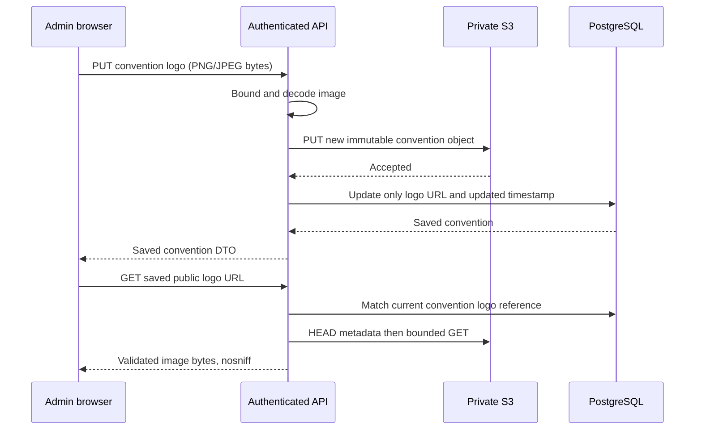

# Convention administration and logo storage

## Saved and draft state

| Concern | Behavior |
| --- | --- |
| Identity and currency | Slug and one convention currency are immutable after creation; final prices are exact decimal strings backed by PostgreSQL NUMERIC |
| Preorders | New conventions are disabled; administrators explicitly enable or disable the single preorder flag. Event calendar dates do not schedule sales |
| Currency/payment choices | Authenticated options endpoint exposes configured backend capabilities; an empty list disables creation without inventing supported payment accounts |
| Metadata, selection and logo | Separate save operations and persisted snapshots; failed requests retain drafts and cannot display success for another operation |
| Membership replacement | Load every saved membership page before editing or saving; catalogue search/pagination never replace the selected map. Backend replaces up to250 memberships atomically |
| Source information | Catalogue displays source currency/price and location-specific available stock. Off-page selected items without observed source data are labeled as not loaded; source stock is informational |
| Navigation | Shared session-scoped draft guard preserves the active editor, confirms departure, and restores native history before proceeding; unsupported browser history protection is reported |
| Markdown | Shared CommonMark preview escapes raw HTML and sanitizes a strict element/attribute/link allowlist; no executable embedded HTML, CSS, images or unsafe schemes |
| Shared presentation | Both applications use the same common stylesheet and form/error/loading primitives; feature requests and drafts remain backoffice-owned |

## Logo upload and read

| Contract | Behavior |
| --- | --- |
| Upload | Existing convention, authenticated ADMIN/SUPER_ADMIN, PNG or JPEG with matching Content-Type; maximum2MiB, positive dimensions up to4096×4096, bounded decode allocation64MiB |
| Object key | `conventions/logos/{convention_id}/{asset_id}`; fresh UUID per upload; no user filenames or arbitrary storage paths |
| Saved URL | Durable server-relative `/api/v1/conventions/{id}/logo/{asset_id}`; browser resolves against configured API origin. No stored signed URL or exposed S3 credentials |
| Public read | Only the convention's current managed reference can be read. Check stored metadata and bounded downloaded bytes; respond with image Content-Type, nosniff and no-store |
| Compatibility | Existing HTTPS logo URLs remain displayable. Explicit metadata URL input still requires HTTPS; omitted managed references survive unrelated PATCH operations |
| Failure | Failed S3 upload leaves the previous database reference intact. A failed database write can leave an unreferenced immutable S3 object; it is not reported as saved |
| Replace/clear/delete | Previous or cleared references become unreadable through the API. Old/unreferenced objects remain in S3; this feature has no object-retention worker |
| Storage isolation | Existing private report storage and signed report downloads retain their behavior; the logo endpoint never accepts report object keys |

Local verification uses controlled S3 and Shopify servers and Docker PostgreSQL; results and provider/browser limits belong in [verification](verification.md).
