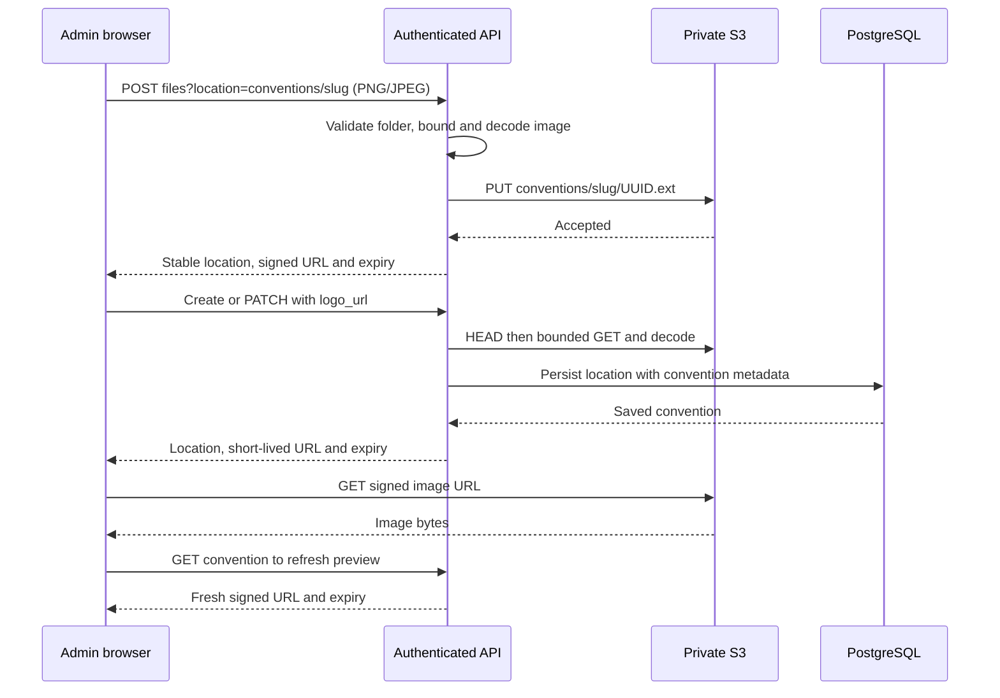

# Conventions and customer portal

## Customer browsing and carts

| Concern | Behavior |
| --- | --- |
| Entry routes | `/` lists enabled conventions whose event has not ended relative to the browser-local date; `/<slug>` lists its products; `/<slug>/products/<product-id>` shows one product and its selected variants; `/<slug>/cart/<cart-id>` edits its browser cart; `/<slug>/checkout/return?checkout_id=…` and `/<slug>/checkout/cancel?checkout_id=…` recover a payment attempt |
| Ordering | Valid hosting IP-country wins; otherwise the browser uses a bounded Country.is IP-country lookup, then its explicit language region, then date-only. The lookup omits credentials/referrer, consumes only alpha2 country and discards IP data. Matching countries first, then event start ascending and stable slug/ID ties; ongoing events remain discoverable. Country changes no prices or permissions |
| Public API | Anonymous `/api/v1/conventions`, `/api/v1/conventions/<slug>`, `/api/v1/conventions/<slug>/products` and `POST /api/v1/conventions/<slug>/quote`; native `/v1` aliases. Disabled/missing conventions expose no metadata or catalogue |
| Catalogue | Complete saved selection, bounded by250 variants; one live Shopify nodes read supplies current descriptions, types, options, images and stock. Final price/currency come from the convention. One card per product links to its detail page; quantity controls and exact variant prices appear only there. Frontend text/SKU/type filters and12/24/48 product-card pages run locally; the page-size selector is below the grid |
| Product identity | Product route IDs are canonical positive decimal Shopify product suffixes kept as text. Detail lookup is restricted to the current convention catalogue; invalid, unknown or removed products expose no variant controls |
| Navigation | The shared Enzumeii logo links home; a top-right cart icon shows total quantity. Product/cart content has a `<` link below the navbar returning to products; no All conventions button is shown |
| Quantity | Visible controls use the label “Quantity” with distinct input associations. Positive quantities through999; active tracked DENY stock caps additions, while CONTINUE preserves out-of-stock ordering. Stock is total shared sellable stock, without a location guarantee or reservation |
| Cart identity | Versioned browser storage is scoped to stable convention identity and a local draft UUID. It stores variant references, quantities and accepted display prices, never personal/payment data. Unknown checkout IDs cannot retrieve another draft |
| Reconciliation | Cart opening, valid quantity input, removal and price acknowledgement automatically refresh catalogue and exact server quotes. Removed/unavailable/insufficient lines require adjustment; changed prices require acknowledgement. Pending or failed quotes never become confirmed current totals. Transient catalogue/quote failures recover automatically. Cart lines show current variant images, falling back to product images or a safe placeholder |
| Failure handling | Malformed or unavailable cart storage has an in-memory fallback; payment requires durable secure recovery storage. Configuration, directory, catalogue and quote reads retry transient network/408/429/5xx failures automatically with serial 5/10/20/30-second capped backoff. Protocol, local validation and terminal HTTP failures stop. API/provider failure remains an error rather than zero stock; signed logo preview failures use placeholders |
| Prices | Exact decimal strings and checked arithmetic; convention-inclusive line prices, one currency and zero shipping. Browser totals are not authority |
| Boundaries | Browsing and cart edits create no order, checkout record, provider payment or stock hold. Payment initiation uses the accepted quote and confirmation email, then the backend validates and reserves a Shopify draft before opening the hosted gateway |
| Contact footer | Every customer route includes icon-only email, Facebook, Instagram, X and TikTok links with accessible names, visible keyboard focus and new-tab navigation. Destinations come from typed public `[contact]` settings loaded once at startup and inherited by environment overrides |
| Shared presentation | Customer pages use the shared logo/favicon, existing common theme, sanitized Markdown with smaller product/variant descriptions, forms/loading/errors and shared Heading. Routing owns navigation; pages/cart own feature state; API services own quote policy |

## Guest payment and confirmation

| Concern | Behavior |
| --- | --- |
| Payment choices | Only currently configured Stripe/PayPal methods render, from fresh catalogue capability metadata; missing capabilities enable no methods. Returning to the cart or focusing its tab refreshes them. Total-bearing “Pay AUD 4.00 via PayPal” and “Pay AUD 4.00 by credit card” labels use the current accepted quote. Equal logo rows sit side by side on wider screens and stack on narrow screens. Card and wallet marks lead to Stripe-hosted Checkout; wallet eligibility remains device/provider dependent |
| Initiation | Configured method buttons remain visible and disabled for an empty cart. A valid confirmation email, accepted current quote and secure browser storage/ownership are required. Cart edits and repeat activation are disabled while preparing payment |
| API | `POST /api/v1/order/checkout` creates or resumes one immutable attempt; `POST /api/v1/order/{checkout_id}/verify` checks it with the same guest bearer. Public Shopify ProductVariant GIDs are accepted, with legacy selection UUID support; the server resolves membership and rejects duplicate resolved variants |
| Payment limits | The existing account read supplies Stripe settlement currency. A known THB-settlement card total below THB10.00 is rejected with a clear422 before creating a checkout or reserving stock. Unknown/cross-settlement minimums remain provider-authoritative; no price increase or FX threshold is invented |
| Terminal rejection | A definite initial gateway rejection, version3 draft rejection without a draft, or proven pre-reservation read failure persists the existing unpaid terminal outcome. Create replay, verify and cron never reinitiate an unpaid checkout without a provider resource. The customer sees saved-cart guidance and polling stops. Old ambiguous attempts, partial/malformed/5xx responses and failures after payment creation retain their original reconciliation fences; legacy records keep compatible recovery |
| Customer note | Optional plain-text field below email accepts up to 2,000 Unicode characters, including line breaks and tabs. Preserve meaningful text exactly in Shopify’s native draft/order note; reject other control characters. Blank browser input is omitted. Notes do not enter provider metadata or the local checkout database |
| Browser recovery | A Web Lock serializes ownership before generating and saving the operation UUID and guest capability. Separate localStorage records hold capability and cart snapshot; email, the optional note and the exact create body stay in sessionStorage. The normal cart contains no contact or payment data. A lost response reuses the original attempt; ambiguous failures never authorize a fresh payment |
| Gateway navigation | Follow only the API redirect action after validating its selected provider's HTTPS host. Return and cancel pages verify independently of catalogue availability. Leaving a gateway does not establish unpaid status; an approved PayPal payment may still be captured under the original instruction |
| Pending payment | Checkout owns its inline progress; background verification and saved-create recovery do not open the global loading dialog. Site logo and reduced-motion-aware shimmer accompany automatic serial checks of the same attempt. Each backend check retrieves current Stripe/PayPal payment evidence even when no webhook arrived. Healthy pending checks wait five seconds; temporary network/408/429/5xx errors back off at 5/10/20/30 seconds. There is no manual status button. Terminal, user-action, reconciliation, invalid/expired credentials and unsafe browser recovery stop polling with specific guidance |
| Confirmation | Only verified `completed` displays the site logo, congratulations and actual Shopify `order.name`, such as `#1234`, verbatim. It asks the customer to check their confirmation email and show it at the convention. Shopify owns confirmation-email delivery |
| Cart preservation | Cancelled, pending and failed attempts preserve the cart. Verified completion clears only the exact saved cart snapshot, preserving newer changes from another tab. Only authoritative unpaid status or a known initiation rejection permits another attempt |
| Automatic recovery | Create, customer verification, authenticated callbacks and the checkout recovery worker share the same business advancement. VPS recovery runs independently of scheduled reports; Vercel uses the existing authenticated `/_cron` invocation. The worker retains the original payment identity, verifies current evidence and stops for operator review when safe continuation is unavailable. See [cron operations](cron.md#checkout-recovery) |
| Independent prices and currencies | New version3 attempts charge the accepted convention total/currency while Shopify uses its own catalogue prices and store currency. Persist payment money before external effects and pin reserved-draft money before gateway creation. Settings changes cannot reprice an existing attempt; no FX conversion or currency relabelling is implied. Legacy versions1/2 keep their original rules. As before, nonpositive Shopify draft totals are rejected before any gateway charge |
| Shopify external payment | New metadata-mode attempts convert the same reserved draft as pending, checkpoint the recording intent and record already received money once through Shopify’s default manual method. Require PAID, zero outstanding and exactly one successful raw `manual` SALE for the exact purchase before confirmation. Financial `completion_version` and identity `correlation_version` are independent; existing rows retain their original replay behavior |
| Slug binding | New `correlation_version = 3` drafts/orders emit one visible tag: the literal convention slug through 40 characters, or its first 40 characters for longer valid slugs. Exact full `convention_slug`, canonical `checkout_id`, `convention_id`, `checkout_correlation_version = 3` and `payment_provider` are singleton custom attributes. Initial drafts also carry `payment_amount_minor`/`payment_currency`; completed orders carry the pinned `shopify_amount_minor`/`shopify_currency` pair. No new correlation, display-name or payment-reference tags are emitted. Existing version 1 rows keep their tag-based reads; tag count never selects the version |
| Accounting | Native gateway/receipt/PaymentSession matching retains its existing path; version3 independent-money orders cannot bypass their strict metadata checks through native matching. New external manual sales require exact structured checkout/convention identity and verified Stripe Session/PaymentIntent/Charge or PayPal Order/Capture references, one fully successful manual sale and complete version3 monetary metadata. Gateway source money matches the pinned convention payment; Shopify order and manual sale match the independent Shopify snapshot. Both order and item rows use the real provider reference; a slug, manual label or opaque Shopify payment ID alone cannot associate them. Legacy tag/refund readers remain; conflicting references fail. Settlement THB is never compared with source AUD/SGD totals |
| Recording limits | Shopify Basic records the full outstanding balance; explicit partial amounts require Plus. Independent Shopify-side edits/payments are outside the checkout lease, so final readback must reject changed money or conflicting transactions. A lost non-idempotent recording response permits same-order reads, never blind replay. Verified provider references are merged idempotently into custom attributes while preserving unrelated keys, then read back; missing, duplicate or conflicting owned metadata cannot complete. PaymentSession IDs belong to genuine Shopify payments-app sessions and are not fabricated |

Controlled tests do not establish actual wallet eligibility, live gateway acceptance, genuine webhook delivery or Shopify email delivery. Record verification results in [verification](verification.md).

## Saved and draft state

| Concern | Behavior |
| --- | --- |
| Identity and currency | Creation derives an API-safe kebab-case slug from the name; slug and currency remain immutable after creation; final prices are exact decimal strings backed by PostgreSQL NUMERIC |
| Preorders | New conventions are disabled; administrators explicitly enable or disable the single preorder flag. Event calendar dates do not schedule sales |
| Country/currency choices | Authenticated options endpoint returns sorted assigned country codes plus supported currencies/payment methods from existing validation and precision/provider rules. Forms use selects; saved currency remains immutable |
| Metadata, selection and logo | Separate save operations and persisted snapshots; failed requests retain drafts. Creation may upload a logo before inserting metadata; retries retain its uploaded location |
| Membership replacement | Load every saved membership page before editing or saving; catalogue search/pagination never replace the selected map. Backend replaces up to250 memberships atomically |
| Catalogue picker | Browse Shopify catalogue opens an 80%-viewport shared popup with larger images and Product type/Product title fields. Backdrop clicks close the popup. Nonblank escaped clauses intersect with AND; empty filters browse eligible products. Every page uses the numeric location configured as `65761018027` in public backoffice settings. Closing retains results, selected variants and price drafts |
| Source information | Rows display separate product/actual variant images and a combined [SKU] Product - Variant title. Missing images and SKUs have explicit placeholders. Source prices show their original currency; a newly selected row retains a small source-price hint beside its independently edited final price |
| Selected variant display | Readonly details are separate from editable membership and exact overridden prices. Search/page changes and legacy saves retain observed details in the current editor; explicit null clears stale details. Enriched saved responses populate fresh views; legacy reloads show unavailable fields truthfully |
| Stock display | Stock quantities, availability badges and location annotations are omitted; no additional stock request runs when loading selections |
| Saved display snapshots | Required Shopify validation persists product/variant titles, nullable SKU, product/variant image URLs and inventory policy with the price. GET reads those snapshots without a provider call; older rows remain nullable until required validation. The UI uses the actual variant image and keeps explicit null distinct from omitted legacy fields |
| Navigation | Shared session-scoped draft guard preserves the active editor and confirms departure. Successful creation clears completion/dirty state and returns to the list; failures preserve drafts and staged upload for retry |
| Markdown | Shared CommonMark preview escapes raw HTML and sanitizes a strict element/attribute/link allowlist; no executable embedded HTML, CSS, images or unsafe schemes |
| Shared presentation | Shared headings compose title/back/actions and wrap long names. Shared interactive tables provide named keyboard-scroll regions and preserve feature-specific classes. Buttons use the existing theme palette and disabled affordances. LogoPicker owns the file box, selected-image preview and rounded discard action for both creation and detail. Feature requests remain backoffice-owned |

## Logo upload and read

| Contract | Behavior |
| --- | --- |
| Ownership | Files handler delegates to `services/files.rs` for upload orchestration; `validations/files.rs` owns image/directory input rules. Convention validation owns canonical logo locations; convention logo service owns attachment/slug association and signed preview projection. Convention service checks payment capabilities before create dependency resolution and after both PATCH merges |
| Upload | Authenticated ADMIN/SUPER_ADMIN can upload before convention creation using `POST /api/v1/admin/files?location=conventions/<slug>`. PNG/JPEG must match Content-Type; maximum2MiB, dimensions1–4096 per axis, bounded decode allocation64MiB |
| Object location | Request location includes bucket and folder: `conventions/<slug>` selects bucket `conventions` and folder `<slug>`. Backend generates the UUID filename and returns `conventions/<slug>/<UUID>.png` or `.jpg`; upload, attachment and preview all use that same bucket/key split. No report-bucket prefix or client-selected filename/provider URL |
| Persistence | Create accepts optional `logo_url`; PATCH preserves missing, clears null, or attaches a validated location for the immutable slug. The existing database `logo_url` column stores the full bucket/key location, never an expiring URL |
| Published schema | The original CREATE migration remains unchanged. The existing `logo_url` column stores uploaded S3 object locations. Legacy HTTPS values remain stored without S3 preview; an administrator can upload and attach an image through the normal flow |
| Attachment | HEAD metadata plus bounded GET and complete image decode validate the object before writing its reference. Missing/invalid objects or provider failures cannot report attachment success |
| Rendering | Convention responses omit the stored `logo_url` and return only transient `logo_preview_url` and RFC3339 `logo_preview_url_expires_at`. Signing uses existing S3 TTL (checked-in300s, maximum900s); signed image GET needs no browser API credentials |
| Preview availability | Create/list/get/PATCH require the shared S3 client and return503 when unavailable. A signing failure with a configured client preserves metadata, returns null URL/expiry and leaves the stored location unchanged; no background polling starts without a signed preview or an actual image failure. Preview URLs refresh automatically 30 seconds before expiry and after image failure, with retries limited to one per minute. Refresh updates only preview state and preserves editor drafts |
| Drafts and retries | Discard/success recreate only the native file input, allowing same-file reselection. Upload/attach failure preserves candidate and metadata/price drafts; an uploaded location is reused for attachment retry. Creation slug changes invalidate its staged location |
| Replace/clear/delete | Old signed URLs can remain usable until expiry. Old/unreferenced objects remain private in storage; no immediate link revocation or garbage collection is provided |
| Failure ordering | Upload signs before PUT. Attachment validates before DB writes. A saved metadata response does not report failure solely because its optional preview could not be signed |
| Storage isolation | Existing private report PUT and signed CSV attachment contracts retain their behavior. Image signing shares transport/destination validation while using inline image semantics |

Local verification uses controlled S3 and Shopify servers and Docker PostgreSQL; results and provider/browser limits belong in [verification](verification.md).
