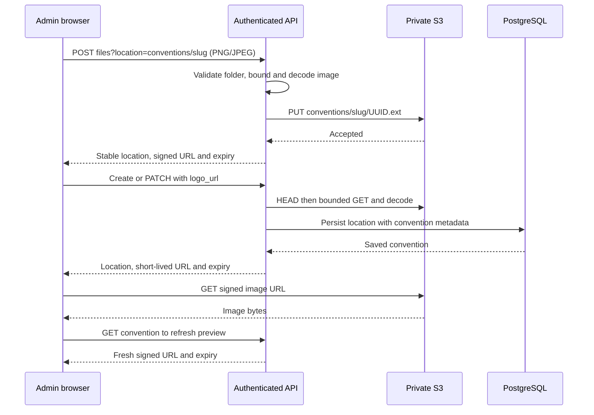

# Convention administration and logo storage

## Saved and draft state

| Concern | Behavior |
| --- | --- |
| Identity and currency | Creation derives an API-safe kebab-case slug from the name; slug and currency remain immutable after creation; final prices are exact decimal strings backed by PostgreSQL NUMERIC |
| Preorders | New conventions are disabled; administrators explicitly enable or disable the single preorder flag. Event calendar dates do not schedule sales |
| Country/currency choices | Authenticated options endpoint returns sorted assigned country codes plus supported currencies/payment methods from existing validation and precision/provider rules. Forms use selects; saved currency remains immutable |
| Metadata, selection and logo | Separate save operations and persisted snapshots; failed requests retain drafts. Creation may upload a logo before inserting metadata; retries retain its uploaded location |
| Membership replacement | Load every saved membership page before editing or saving; catalogue search/pagination never replace the selected map. Backend replaces up to250 memberships atomically |
| Catalogue picker | Browse Shopify catalogue opens an 80%-viewport shared popup with larger images and Product type/Product title fields. Backdrop clicks close the popup. Nonblank escaped clauses intersect with AND; empty filters browse eligible products. Every page uses the numeric location configured as `65761018027` in public backoffice settings. Closing retains results, selected variants and price drafts |
| Source information | Rows display separate product/actual variant images and a combined [SKU] Product - Variant title. Missing images and SKUs have explicit placeholders. Source prices show their original currency; a newly selected row retains a small source-price hint beside its independently edited final price |
| Selected variant display | Readonly details are separate from editable membership and exact overridden prices. Search/page changes and legacy saves retain observed details in the current editor; explicit null clears stale details. Enriched saved responses populate fresh views; legacy reloads show unavailable fields truthfully |
| Stock display | Stock quantities, availability badges and location annotations are omitted; no additional stock request runs when loading selections |
| Saved display snapshots | Required Shopify validation persists product/variant titles, nullable SKU, product/variant image URLs and inventory policy with the price. GET reads those snapshots without a provider call; older rows remain nullable until required validation. The UI uses the actual variant image and keeps explicit null distinct from omitted legacy fields |
| Navigation | Shared session-scoped draft guard preserves the active editor and confirms departure. Successful creation clears completion/dirty state and returns to the list; failures preserve drafts and staged upload for retry |
| Markdown | Shared CommonMark preview escapes raw HTML and sanitizes a strict element/attribute/link allowlist; no executable embedded HTML, CSS, images or unsafe schemes |
| Shared presentation | Shared headings compose title/back/actions and wrap long names. Shared interactive tables provide named keyboard-scroll regions and preserve feature-specific classes. Buttons use the existing theme palette and disabled affordances. LogoPicker owns the file box, selected-image preview and rounded discard action for both creation and detail. Feature requests remain backoffice-owned |

## Logo upload and read

| Contract | Behavior |
| --- | --- |
| Ownership | Files handler delegates to `services/files.rs` for upload orchestration; `validations/files.rs` owns image/directory input rules. Convention validation owns canonical logo locations; convention logo service owns attachment/slug association and signed preview projection. Convention service checks payment capabilities before create dependency resolution and after both PATCH merges |
| Upload | Authenticated ADMIN/SUPER_ADMIN can upload before convention creation using `POST /api/v1/admin/files?location=conventions/<slug>`. PNG/JPEG must match Content-Type; maximum2MiB, dimensions1–4096 per axis, bounded decode allocation64MiB |
| Object location | Request location includes bucket and folder: `conventions/<slug>` selects bucket `conventions` and folder `<slug>`. Backend generates the UUID filename and returns `conventions/<slug>/<UUID>.png` or `.jpg`; upload, attachment and preview all use that same bucket/key split. No report-bucket prefix or client-selected filename/provider URL |
| Persistence | Create accepts optional `logo_url`; PATCH preserves missing, clears null, or attaches a validated location for the immutable slug. The existing database `logo_url` column stores the full bucket/key location, never an expiring URL |
| Published schema | The original CREATE migration remains unchanged. The existing `logo_url` column stores uploaded S3 object locations. Legacy HTTPS values remain stored without S3 preview; an administrator can upload and attach an image through the normal flow |
| Attachment | HEAD metadata plus bounded GET and complete image decode validate the object before writing its reference. Missing/invalid objects or provider failures cannot report attachment success |
| Rendering | Convention responses omit the stored `logo_url` and return only transient `logo_preview_url` and RFC3339 `logo_preview_url_expires_at`. Signing uses existing S3 TTL (checked-in300s, maximum900s); signed image GET needs no browser API credentials |
| Preview availability | Create/list/get/PATCH require the shared S3 client and return503 when unavailable. A signing failure with a configured client preserves metadata, returns null URL/expiry and leaves the stored location unchanged; no background polling starts without a signed preview or an actual image failure. Preview URLs refresh automatically 30 seconds before expiry and after image failure, with retries limited to one per minute. Refresh updates only preview state and preserves editor drafts |
| Drafts and retries | Discard/success recreate only the native file input, allowing same-file reselection. Upload/attach failure preserves candidate and metadata/price drafts; an uploaded location is reused for attachment retry. Creation slug changes invalidate its staged location |
| Replace/clear/delete | Old signed URLs can remain usable until expiry. Old/unreferenced objects remain private in storage; no immediate link revocation or garbage collection is provided |
| Failure ordering | Upload signs before PUT. Attachment validates before DB writes. A saved metadata response does not report failure solely because its optional preview could not be signed |
| Storage isolation | Existing private report PUT and signed CSV attachment contracts retain their behavior. Image signing shares transport/destination validation while using inline image semantics |

Local verification uses controlled S3 and Shopify servers and Docker PostgreSQL; results and provider/browser limits belong in [verification](verification.md).
