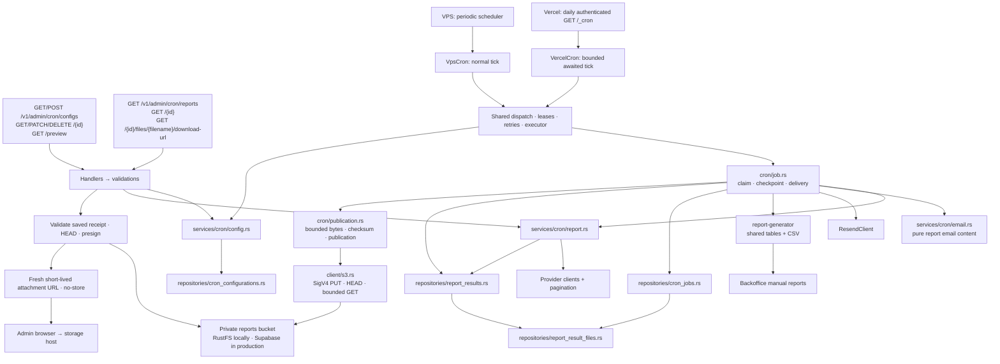
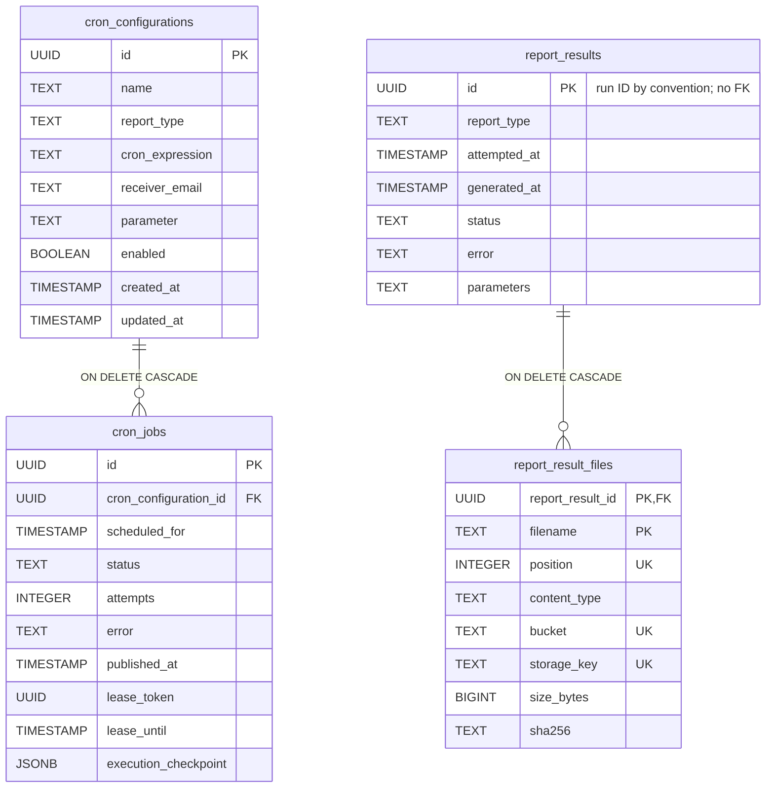
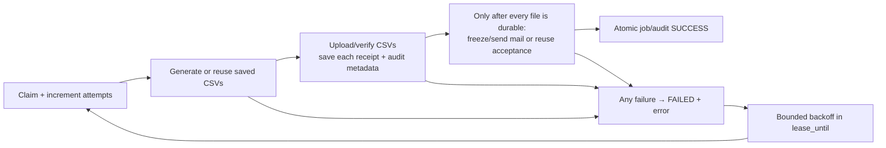

# Scheduled reports

## Ownership and endpoints

| Contract | Meaning |
| --- | --- |
| Invocation | Selected VPS or Vercel cron implementation shares one queue/executor. VPS polls every 10 seconds and retains hourly; Vercel has an authenticated daily UTC wake-up with 240-second budget and five-second retention reserve. Both evaluate stored Bangkok schedules. |
| Config parameter | Transaction recurrence policy, or decimal inventory location ID. |
| Report parameters | Resolved Bangkok range, or inventory ID. Range text is converted to a half-open interval internally. |
| Status | One PENDING/SUCCESS/FAILED value per job/audit. SUCCESS requires generation, email provider acceptance and publication. |
| Error | Latest safe failure names the step; unconfirmed mail may have been sent. |
| Files | Each verified receipt appears immediately, even if another file or email fails. History exposes filename/content_type only; an authenticated click requests a fresh private S3 download URL. |
| Formats | Scheduled output is CSV only. Backoffice manual XLSX remains a separate wrapper over shared projected rows. |
| Config edits | Every edit starts a future revision; undispatched older backlog is discarded. Unstarted jobs use current configuration, started reports retain frozen context. |
| Deletion | Cascade deletes jobs and cancels incomplete audits. Independent audits/published files remain. In-flight external sends cannot be recalled. |

## Cron implementation selection

| Cron contract | Behavior |
| --- | --- |
| Configuration | One existing typed reader composes application.toml and the local/prod overlay with trusted metadata and secret overrides; local configuration can select either cron implementation, while production selects Vercel |
| VPS lifecycle | Startup owns scheduler and independent retention task handles; shutdown stops and awaits both before closing the database |
| Vercel lifecycle | No background loops; VercelCron awaits shared bounded invocation through Vercel-only `/_cron` |
| Disabled scheduler | Skip report dispatch/drain; shared refresh-token retention continues |
| Settings | scheduler.implementation selects vps/vercel; poll_interval_secs, retention_interval_secs, invocation_budget_secs and retention_reserve_secs remain in the existing scheduler configuration; no extra application runtime/profile files |
| Capacity | No new claims after deadline; owned async work is cancelled/joined. Partial provider acquisition is not resumable; repeated oversized jobs can exhaust attempts |

## Database fields

The tables contain 9 configuration fields, 10 job fields, 7 audit fields and 8 receipt fields. All SQL timestamps are UTC-normalized TIMESTAMP WITHOUT TIME ZONE. Receipt constraints require nonempty metadata, nonnegative position/size and 64 lowercase hexadecimal hash digits. Report/filename, report/position and bucket/key identities are unique.

| Table | Field | Usage |
| --- | --- | --- |
| cron_configurations | id | Configuration identity. |
| | name | Validated admin label. |
| | report_type | TRANSACTION or INVENTORY, validated by Rust. |
| | cron_expression | Five-field Bangkok recurrence. |
| | receiver_email | Current recipient. |
| | parameter | PREVIOUS_MONTH/FIRST_HALF_MONTH or inventory ID. |
| | enabled | Controls future dispatch. |
| | created_at | Creation time. |
| | updated_at | Edit time and schedule revision boundary; advances for conditional updates. |
| cron_jobs | id | Run identity, audit/file namespace and idempotency key. |
| | cron_configuration_id | Configuration FK, ON DELETE CASCADE. |
| | scheduled_for | Occurrence; unique with configuration ID. |
| | status | Whole workflow status. |
| | attempts | One total claim/attempt budget. |
| | error | Safe failed-step description. |
| | published_at | Whole workflow completion after publication and email acceptance. |
| | lease_token | Ownership fence. |
| | lease_until | Active expiry or token-free retry eligibility; null on terminal failure. |
| | execution_checkpoint | Nullable private metadata: frozen generation date/keys, expected sizes/SHA-256, verified receipts and frozen sending/accepted mail intent. No CSV bytes; deleted with the job and excluded from API DTOs. |
| report_results | id | Independent audit; no configuration/job FK. |
| | report_type | Actual type frozen at first claim. |
| | attempted_at | First actual attempt. |
| | generated_at | Generation completion, nullable even on failed workflow. |
| | status | Overall outcome. |
| | error | Current safe failure/uncertainty/cancellation message. |
| | parameters | Frozen range or inventory ID. |
| report_result_files | report_result_id, filename | Canonical immutable receipt; parent deletion cascades its receipts. No URL column. |
| | position | Frozen file order: inventory.csv / transactions.csv = 0, items.csv = 1, even when items publishes first. |
| | content_type, bucket, storage_key, size_bytes, sha256 | Verified private object metadata; exact retries are idempotent and conflicting receipts are rejected. |
| History reads | list/detail | One SQL snapshot pages audit parents before joining ordered receipts; empty audits remain visible. |

## Retry and storage

| Concern | Mechanism |
| --- | --- |
| Deduplication | Configuration locking and UNIQUE(configuration, scheduled_for). |
| Upcoming execution | Calculated by GET preview; no stored next_run_at. |
| Restart | Durable job metadata and verified S3 bytes; no report filesystem persistence. |
| Accepted email | Reused without resending. Unconfirmed sends retry with the same request/key only inside the provider's 24-hour window. |
| Private state | cron_jobs.execution_checkpoint JSONB stores metadata only. Lease/token/PENDING/unexpired checks and compare-and-update fence every transition. Audit generation date and canonical child receipts commit in the same transaction after checkpoint compare-and-update; completion verifies these receipts before SUCCESS. |
| Object identity | Keys use `type/Bangkok-YYYYMMDD/report-UUID/sha256/filename`. The concrete AWS S3 SDK client uses the same operations locally and in production. Validate report/bucket/key/hash before storage I/O. |
| S3 protocol | SigV4 HEAD/PUT/GET; bounded reads/deadlines and one SDK attempt. PUT is an upsert; publication permits replacements only with identical frozen bytes at the same hash-bearing key. |
| Recovery | Expected keys, sizes and SHA-256 reconcile accepted uploads after a lost response. A process crash before all CSV uploads finish can permanently lose missing bytes: mark failure, retain available receipts and never regenerate or email an incomplete report. Transport uncertainty consumes the ordinary whole-job retry budget. |
| Scheduled email | Verified CSV bytes remain attachments; email does not depend on expiring links. New intents use reporting@enzumeii.com with report type, frozen inventory ID or inclusive Bangkok range, and saved generation timestamp in subject and HTML. Generation timestamps use Asia/Bangkok (UTC+07:00). Existing intents retain sender, recipient, content, time and idempotency key. |
| Authorization | History/detail/signing require existing admin authentication. The `reports` bucket stays private. Signing validates saved metadata and HEAD, then returns URL plus UTC expires_at with Cache-Control no-store. A URL is a temporary bearer credential: anyone holding it can download until expiry; never persist or log it. |
| Integrity | Checksums during prepare/recovery/publication. File hosting after publication belongs to storage. |

## Local commands

| Command / setting | Local behavior |
| --- | --- |
| API `just setup` | Fill missing/empty S3_ACCESS_KEY_ID and S3_SECRET_ACCESS_KEY with synthetic local defaults; preserve all nonempty values and existing secrets. |
| API `just run` | Start Compose PostgreSQL/local-s3, initialize private reports bucket, migrate the local database and run API; stop only owned S3 on exit. |
| Root `just vercel-dev` | Load local API settings, start/init S3 independently, prebuild UI bundles and run existing Vercel services; stop only owned S3 on exit. Optional `--port`, `--queue-port`, `--runtime-cache-port`, `--schedules-port` preserve defaults 18027/55461/55462/55463. |
| Ordinary restart | Pinned RustFS1.0.3 and local_s3_data persist across stop/start and `just db-down`; do not delete development volumes. |
| Local settings | Existing application.local.toml `client.s3.endpoint` must match LOCAL_S3_PORT (default3001); common region ap-southeast-1 and bucket reports. Keep S3 credentials separate from DATABASE_URL/JWT_SECRET. |
| API `just test` | Dedicated Compose PostgreSQL/local-s3/init → native Cargo once → registered TCP suite → owned Compose down -v, including failure. |
| Test isolation | Unique E2E_COMPOSE_PROJECT, E2E_POSTGRES_PORT, E2E_S3_PORT and matching E2E_DATABASE_URL; dedicated E2E_S3_ACCESS_KEY_ID/E2E_S3_SECRET_ACCESS_KEY default to fixed synthetic credentials, never production S3 keys. |
| Cron selection | Local application.local.toml selects VPS polling or manual Vercel cron; production still forces Vercel in the one existing reader. |
| Postman | The three external S3 requests exercise SigV4 PUT/HEAD/GET; supply credentials privately through environment values. Internal reports/download-url requests a fresh signed URL under the authenticated no-store contract; fetching that URL is a separate manual step. |

| Production readiness | Boundary |
| --- | --- |
| Target | Supabase S3 endpoint is checked into common/prod TOML, region ap-southeast-1, bucket reports, path-style addressing. |
| Private access | An authorized operator must separately create/confirm private reports bucket and supply S3_ACCESS_KEY_ID/S3_SECRET_ACCESS_KEY through Vercel secrets. Database passwords/API keys are not S3 access keys. |
| Evidence | Local RustFS and controlled network fixtures verify application behavior. Dashboard privacy, actual Supabase credentials/authorization, provider compatibility, smoke and deployment require separately authorized live verification. |
| Existing objects | No legacy copy is required. Missing checkpointed objects fail safely; regeneration is disabled. Existing user containers/data are untouched. |
