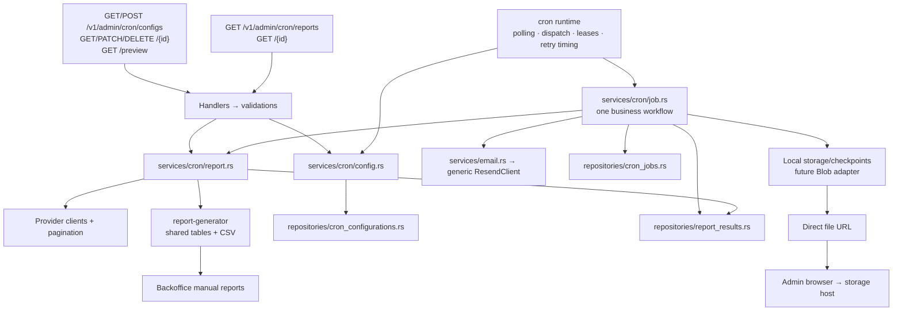
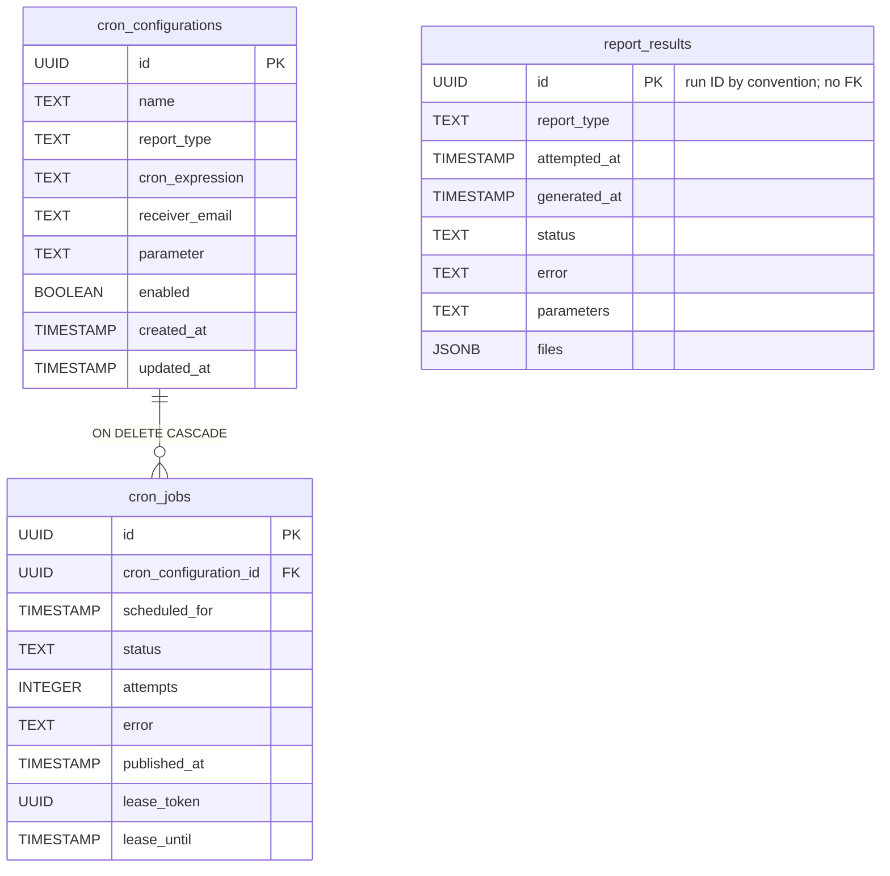
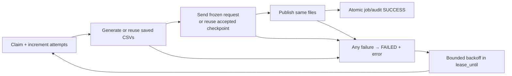

# Scheduled reports

## Ownership and endpoints



| Contract | Meaning |
| --- | --- |
| Config parameter | Transaction recurrence policy, or decimal inventory location ID. |
| Report parameters | Resolved Bangkok range, or inventory ID. Range text is converted to a half-open interval internally. |
| Status | One PENDING/SUCCESS/FAILED value per job/audit. SUCCESS requires generation, email provider acceptance and publication. |
| Error | Latest safe failure names the step; unconfirmed mail may have been sent. |
| Files | Metadata appears after publication. History serves metadata; bytes come directly from storage. |
| Formats | Scheduled output is CSV only. Backoffice manual XLSX remains a separate wrapper over shared projected rows. |
| Config edits | Every edit starts a future revision; undispatched older backlog is discarded. Unstarted jobs use current configuration, started reports retain frozen context. |
| Deletion | Cascade deletes jobs and cancels incomplete audits. Independent audits/published files remain. In-flight external sends cannot be recalled. |

## Database fields



All SQL timestamps are UTC-normalized TIMESTAMP WITHOUT TIME ZONE. There are no business-value CHECK constraints. Primary keys, required columns, occurrence uniqueness and the cascade FK remain.

| Table | Field | Usage |
| --- | --- | --- |
| cron_configurations | id | Configuration identity. |
| | name | Validated admin label. |
| | report_type | TRANSACTION or INVENTORY, validated by Rust. |
| | cron_expression | Five-field Bangkok recurrence. |
| | receiver_email | Current recipient. |
| | parameter | PREVIOUS_MONTH/FIRST_HALF_MONTH or inventory ID. |
| | enabled | Controls future dispatch. |
| | created_at | Creation time. |
| | updated_at | Edit time and schedule revision boundary; advances for conditional updates. |
| cron_jobs | id | Run identity, audit/file namespace and idempotency key. |
| | cron_configuration_id | Configuration FK, ON DELETE CASCADE. |
| | scheduled_for | Occurrence; unique with configuration ID. |
| | status | Whole workflow status. |
| | attempts | One total claim/attempt budget. |
| | error | Safe failed-step description. |
| | published_at | Final publication checkpoint. |
| | lease_token | Ownership fence. |
| | lease_until | Active expiry or token-free retry eligibility; null on terminal failure. |
| report_results | id | Independent audit; no configuration/job FK. |
| | report_type | Actual type frozen at first claim. |
| | attempted_at | First actual attempt. |
| | generated_at | Generation completion, nullable even on failed workflow. |
| | status | Overall outcome. |
| | error | Current safe failure/uncertainty/cancellation message. |
| | parameters | Frozen range or inventory ID. |
| | files | Published file metadata, with internal relative storage keys and direct URLs. |

## Retry and storage



| Concern | Mechanism |
| --- | --- |
| Deduplication | Configuration locking and UNIQUE(configuration, scheduled_for). |
| Upcoming execution | Calculated by GET preview; no stored next_run_at. |
| Restart | Durable jobs and private file checkpoints. |
| Accepted email | Reused without resending. Unconfirmed sends retry with the same request/key only inside the provider's 24-hour window. |
| Private state | Generated manifest, frozen mail request and acceptance marker remain outside public/. |
| Direct local files | Separate loopback static host exposes public/<run-id>/*.csv only. |
| Future Blob | Publisher returns object URLs; credentials/location and access policy remain deferred. |
| Authorization | Metadata uses API authentication. Direct URLs use their storage host's access policy. |
| Integrity | Checksums during prepare/recovery/publication. File hosting after publication belongs to storage. |

## Local commands

Python 3.11+ is required for the TOML-based local static helper. Configure reports.storage backend, directory and public_base_url explicitly in the API TOML. The local serving URL must use loopback HTTP.

```bash
just --justfile services/api/justfile serve-reports
just --justfile services/api/justfile run
just --justfile services/api/justfile test
just --justfile crates/report-generator/justfile check
just --justfile crates/report-generator/justfile test
```

Use unique E2E_COMPOSE_PROJECT, E2E_POSTGRES_PORT and E2E_DATABASE_URL values when another worktree is running tests.
