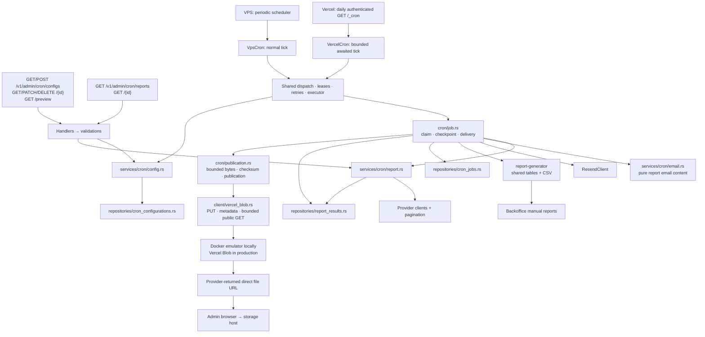
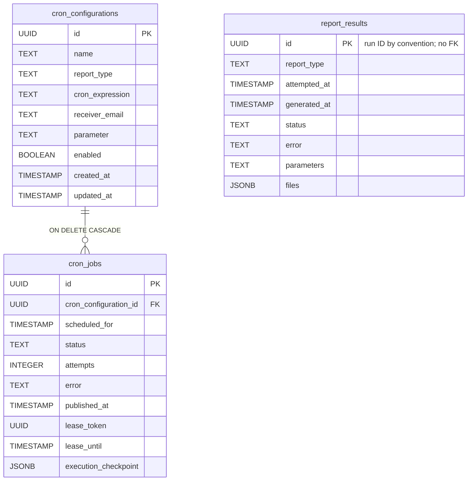
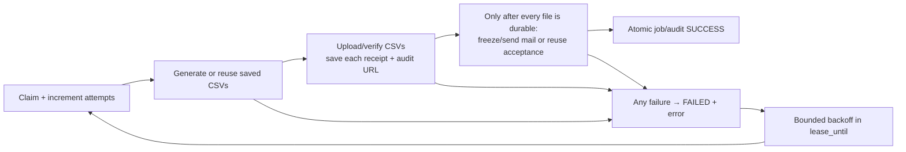

# Scheduled reports

## Ownership and endpoints



| Contract | Meaning |
| --- | --- |
| Invocation | Selected VPS or Vercel cron implementation shares one queue/executor. VPS polls every 10 seconds and retains hourly; Vercel has an authenticated daily UTC wake-up with 240-second budget and five-second retention reserve. Both evaluate stored Bangkok schedules. |
| Config parameter | Transaction recurrence policy, or decimal inventory location ID. |
| Report parameters | Resolved Bangkok range, or inventory ID. Range text is converted to a half-open interval internally. |
| Status | One PENDING/SUCCESS/FAILED value per job/audit. SUCCESS requires generation, email provider acceptance and publication. |
| Error | Latest safe failure names the step; unconfirmed mail may have been sent. |
| Files | Each verified URL appears immediately, even if another file or email fails. History serves metadata; bytes come directly from Vercel Blob. |
| Formats | Scheduled output is CSV only. Backoffice manual XLSX remains a separate wrapper over shared projected rows. |
| Config edits | Every edit starts a future revision; undispatched older backlog is discarded. Unstarted jobs use current configuration, started reports retain frozen context. |
| Deletion | Cascade deletes jobs and cancels incomplete audits. Independent audits/published files remain. In-flight external sends cannot be recalled. |

## Cron implementation selection

| Cron contract | Behavior |
| --- | --- |
| Configuration | One existing typed reader composes application.toml and the local/prod overlay with trusted metadata and secret overrides; local configuration can select either cron implementation, while production selects Vercel |
| VPS lifecycle | Startup owns scheduler and independent retention task handles; shutdown stops and awaits both before closing the database |
| Vercel lifecycle | No background loops; VercelCron awaits shared bounded invocation through Vercel-only `/_cron` |
| Disabled scheduler | Skip report dispatch/drain; shared refresh-token retention continues |
| Settings | scheduler.implementation selects vps/vercel; poll_interval_secs, retention_interval_secs, invocation_budget_secs and retention_reserve_secs remain in the existing scheduler configuration; no extra application runtime/profile files |
| Capacity | No new claims after deadline; owned async work is cancelled/joined. Partial provider acquisition is not resumable; repeated oversized jobs can exhaust attempts |

## Database fields



The tables contain 9 configuration fields, 10 job fields and 8 audit fields. All SQL timestamps are UTC-normalized TIMESTAMP WITHOUT TIME ZONE. There are no business-value CHECK constraints. Primary keys, required columns, occurrence uniqueness and the cascade FK remain.

| Table | Field | Usage |
| --- | --- | --- |
| cron_configurations | id | Configuration identity. |
| | name | Validated admin label. |
| | report_type | TRANSACTION or INVENTORY, validated by Rust. |
| | cron_expression | Five-field Bangkok recurrence. |
| | receiver_email | Current recipient. |
| | parameter | PREVIOUS_MONTH/FIRST_HALF_MONTH or inventory ID. |
| | enabled | Controls future dispatch. |
| | created_at | Creation time. |
| | updated_at | Edit time and schedule revision boundary; advances for conditional updates. |
| cron_jobs | id | Run identity, audit/file namespace and idempotency key. |
| | cron_configuration_id | Configuration FK, ON DELETE CASCADE. |
| | scheduled_for | Occurrence; unique with configuration ID. |
| | status | Whole workflow status. |
| | attempts | One total claim/attempt budget. |
| | error | Safe failed-step description. |
| | published_at | Whole workflow completion after publication and email acceptance. |
| | lease_token | Ownership fence. |
| | lease_until | Active expiry or token-free retry eligibility; null on terminal failure. |
| | execution_checkpoint | Nullable private metadata: frozen generation date/keys, expected sizes/SHA-256, verified receipts and frozen sending/accepted mail intent. No CSV bytes; deleted with the job and excluded from API DTOs. |
| report_results | id | Independent audit; no configuration/job FK. |
| | report_type | Actual type frozen at first claim. |
| | attempted_at | First actual attempt. |
| | generated_at | Generation completion, nullable even on failed workflow. |
| | status | Overall outcome. |
| | error | Current safe failure/uncertainty/cancellation message. |
| | parameters | Frozen range or inventory ID. |
| | files | Published file metadata, with internal relative storage keys and direct URLs. |

## Retry and storage



| Concern | Mechanism |
| --- | --- |
| Deduplication | Configuration locking and UNIQUE(configuration, scheduled_for). |
| Upcoming execution | Calculated by GET preview; no stored next_run_at. |
| Restart | Durable job metadata and verified Blob bytes; no report filesystem persistence. |
| Accepted email | Reused without resending. Unconfirmed sends retry with the same request/key only inside the provider's 24-hour window. |
| Private state | cron_jobs.execution_checkpoint JSONB stores metadata only. Lease/token/PENDING/unexpired checks and compare-and-update fence every transition. Audit generation date and file receipts commit in the same transaction. |
| Direct downloads | The same Rust HTTP client uploads to a pinned Docker Vercel Blob emulator locally and Vercel Blob when configured. Keys use type/Bangkok generation date/audit ID/filename. Stored URLs come from provider responses. |
| Blob protocol | API version 13: raw PUT with public access, random suffix and overwrite disabled; authenticated metadata GET by pathname; unauthenticated bounded GET for verified content. No hidden PUT retries. |
| Recovery | Expected keys, sizes and SHA-256 reconcile accepted uploads after a lost response. A process crash before all CSV uploads finish can permanently lose missing bytes: mark failure, retain available URLs and never regenerate or email an incomplete report. Transport uncertainty consumes the ordinary whole-job retry budget. |
| Scheduled email | New intents use reporting@enzumeii.com with report type, frozen inventory ID or inclusive Bangkok range, and saved generation timestamp in subject and HTML. Generation timestamps use Asia/Bangkok (UTC+07:00). Existing intents retain sender, recipient, content, time and idempotency key. |
| Authorization | Metadata uses API authentication. Direct URLs use their storage host's access policy. |
| Integrity | Checksums during prepare/recovery/publication. File hosting after publication belongs to storage. |

## Local commands

Configure client.vercel_blob endpoint/timeout in application.local.toml; provide BLOB_READ_WRITE_TOKEN as a secret for production. `just setup` fills missing or empty BLOB_READ_WRITE_TOKEN in .env with the synthetic local emulator token while preserving nonempty values. `just run` loads that token from .env for both the API and local Blob emulator, starts Compose services and waits for readiness. The local-blob volume survives ordinary shutdown; E2E owns separate resources and deletes its test volume. No Python file server or legacy filesystem import is used. Existing files remain untouched; old local static-server URLs are not migrated automatically.

The emulator image is pinned to ghcr.io/lafittemehdy/vercel-blob-local@sha256:9e85fdc2c7ff691bdd4b6d5457e4d8cb3a0beb010724adc594786cd76395a31c. Its Docker host binding is loopback. LOCAL_BLOB_PORT and LOCAL_BLOB_PUBLIC_URL must match the API's typed local endpoint when changing ports. Production Vercel credentials, CDN behavior and deployment are unverified; private execution metadata requires PostgreSQL, while all generated files live in Blob.

```bash
just --justfile services/api/justfile run
just --justfile services/api/justfile test
just --justfile crates/report-generator/justfile check
just --justfile crates/report-generator/justfile test
```

Use unique E2E_COMPOSE_PROJECT, E2E_POSTGRES_PORT, E2E_BLOB_PORT, matching E2E_BLOB_PUBLIC_URL and E2E_DATABASE_URL values when another worktree is running tests.
