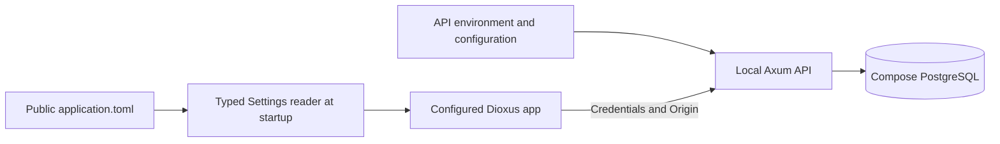
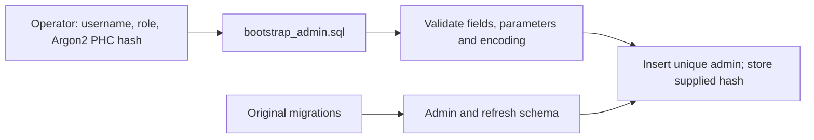

# Development and operations

| Reference | Content |
| --- | --- |
| [Architecture](architecture.md) | Ownership, structure, auth flow, branch changes |
| [Verification](verification.md) | Results and coverage limits |
| Package README / justfile | Prerequisites and reusable commands |

## Configuration

| Owner | Setting | Meaning |
| --- | --- | --- |
| API | `application.toml` + optional `application.{RUN_ENV}.toml` | Server configuration overlay; RUN_ENV defaults to local |
| API | `DATABASE_URL` | PostgreSQL secret connection URL |
| API | `JWT_SECRET` | Hex-encoded random signing key; at least 32 bytes |
| API | `API_HOST` / `API_PORT` | Listener overrides |
| API | `PUBLIC_ORIGIN` | Exact allowed UI origin |
| API | `INSECURE_LOCAL_COOKIES` | Explicit loopback HTTP; false for production HTTPS |
| Backoffice | `application.toml`: `[api] base_url` | Public API URL including `/v1`; default `http://127.0.0.1:3000/v1` |
| Backoffice | `config.rs`: `Settings` / `ApiConfig` | Load/parse the public TOML once at startup before pages or API calls |
| Frontend file | Served as a Dioxus asset | Public settings only; no secrets or alternate configuration mechanism |
| Backoffice | Existing serve recipe | UI at `http://127.0.0.1:8084` |
| Local host spelling | Use `127.0.0.1` consistently | Different ports: cross-origin, same-site |
| Production browser | HTTPS, exact origin, same-site UI/API | Secure cookie; cross-site policy requires separate design |

| Startup outcome | App behavior |
| --- | --- |
| Loading configuration | Loading indicator; pages/API calls wait |
| TOML loaded and parsed | Provide typed settings to app; restore session |
| Fetch/parse failure | Show error and Retry; no configured app/API calls |

| Configuration status | State |
| --- | --- |
| Current frontend source | `apps/backoffice/application.toml`; one public Dioxus asset |
| Planned deployment sources | `application.local.toml` / `application.prod.toml`; select and publish as `application.toml` |
| Deployment selection | Not implemented; runtime reader remains single |
| Known loader defect | Asset path needs browser-origin resolution before reqwest |
| Known strict-lint failure | Asset macro inside deserialized Settings impl triggers `unsafe_derive_deserialize` |

## Validation and failures

| Input / failure | Rule / response |
| --- | --- |
| Username | 1–20 Unicode characters; no surrounding/all whitespace |
| New password | 12–128 characters |
| Existing login password | Shorter legacy passwords accepted; upper bound 128 |
| Invalid update | 400 |
| Duplicate username | 409 |
| Internal failure | Generic 500 |
| Error conversions | Pure; no logging side effects |
| Error/warning events | `src/error.rs`, once at HTTP/startup/maintenance boundary |
| Logs / Debug | Operation/category only; redact credentials, causes and database URLs |

## Runtime

| Concern | Mechanism |
| --- | --- |
| Argon2 | Direct Tokio `spawn_blocking`; no admission limiter |
| Database pool | One connection; unchanged |
| API shutdown | Native Axum graceful shutdown; Ctrl-C/SIGTERM future |
| UI serving | Dioxus CLI lifecycle |
| Refresh retention | Startup + hourly ticks; at most 500 rows per batch; skip locked rows |
| Vercel | Listener/maintenance not adapted to functions |

## Schema and operator bootstrap

| Operation | Policy |
| --- | --- |
| Admin/seed migrations | Preserve intentional behavior |
| Refresh migration | Family/retention additions merged into `20260829090958_add_refresh_token.sql` |
| Two later drafts | Removed under explicit pre-production authorization |
| Applied production history | Not a precedent for rewriting migrations |
| Bootstrap | Existing `bootstrap-admin` recipe; explicit SQL outside migrations |
| Operator input | Username, role, Argon2 PHC hash file |
| SQL validation | Unicode/role boundaries, PHC parameters/encoding/storage limits |
| Duplicate bootstrap | Reject; no overwrite |
| Password handling | Store hash only; operator generates from a 12–128-character password |
| PHC limitation | Plaintext length cannot be recovered from hash |
| Key rotation | Old access signatures fail; valid refresh can obtain a newly signed JWT |

## Tests and commands

| Concern | Existing placement / command |
| --- | --- |
| Installer / root guide | `init.sh` installs pinned CLI packages; root README links package guides and docs |
| API startup/test/check | `services/api/justfile`: `run`, `test`, `check` |
| UI serving/build/test/check | `apps/backoffice/justfile`: `serve`, `build`, `test`, `check` |
| Client UI local workflow | `apps/client-ui/justfile`: `setup`, `run`, `test`, `check`; run prints the current stub |
| Domain local workflow | `crates/domain/justfile`: `setup`, `test`, `check`; library has no server |
| Shared contract checks | Domain/backoffice `test` recipes include domain contract tests and WASM compilation |
| Unit-test convention | When unit tests exist, use the crate's `src/tests/`, mirroring core modules; current API/backoffice tests follow this |
| Domain contract test | `crates/domain/tests/contracts.rs`; public integration contract, separate from unit-test convention |
| Backoffice HTTP unit mapping | `src/api.rs` → `src/tests/api.rs` |
| Unit private access | Test-gated child-module registration |
| API E2E | `services/api/e2e-test/{healthz,v1/auth,v1/admins}.rs` |
| E2E registration | API Cargo `[[test]]`: `name = "e2e"`, `path = "e2e-test/main.rs"` |
| Shared E2E utilities | `e2e-test/common.rs` owns API environment, child process, readiness and teardown; endpoint helpers remain with endpoint tests |
| API test sequence | Native `cargo test` → Compose up → `cargo api-e2e` → Compose down `-v`, including on failure |
| Database lifetime | Shared across tests within a run; deleted after the run |
| Dependency | Existing Compose PostgreSQL; API runs locally over TCP |
| Fixtures | Unique owned rows; cleanup only own rows/controls |
| Race controls | Detached connections release advisory locks on failure |
| Retention test | Connection-owned temporary table/rows |
| Backoffice/browser E2E | Excluded by request |
