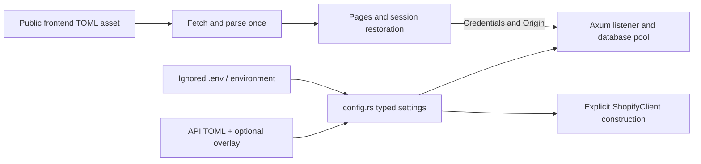

# Development and operations

Use each package's README and justfile for prerequisites and commands. [Architecture](architecture.md) describes ownership and behavior; [verification](verification.md) records the current evidence.

## Configuration

| Owner | Source / setting | Behavior |
| --- | --- | --- |
| API | `application.toml`, then optional `application.{RUN_ENV}.toml` | Environment overlay; `RUN_ENV` defaults to `local` |
| API listener | `server.host`, `server.port` in TOML | Non-secret bind settings |
| API browser | `browser.public_origin`, `browser.insecure_local` in TOML | Exact origin; HTTPS unless explicitly using loopback HTTP |
| Database | `DATABASE_URL` from ignored `.env` or environment | Secret PostgreSQL connection URL |
| Signing key | `JWT_SECRET` from ignored `.env` or environment | Hex-encoded random key of at least 32 bytes |
| Shopify URL | `client.shopify.admin_api_url` in `services/api/application.toml` | Full `https://<shop>.myshopify.com/admin/api/2026-10/graphql.json`; local overlay does not replace it |
| Shopify token | `SHOPIFY_ACCESS_TOKEN` from ignored API `.env` or environment | Loaded by `config.rs` into redacted runtime config; never read directly by the client or accepted from TOML |
| Backoffice | Public `application.toml`, `[api] base_url` | Default `http://localhost:3000/v1`; loaded once by typed `Settings`/`ApiConfig` |
| Local browser | UI `http://localhost:8084`, API `http://localhost:3000` | Same hostname is required for exact origins and SameSite cookies |
| Production browser | HTTPS and exact same-site UI/API origin configuration | Cross-site deployment needs a separate cookie/CORS design |
| Frontend environments | One published `application.toml` | Build-time local/prod file selection is planned, not implemented |

Inherited environment variables keep dotenvy's normal precedence. API non-secret listener/browser settings do not use environment overrides. Missing Shopify configuration/credentials does not prevent normal API startup; explicit Shopify client construction requires a valid URL and token.

| Backoffice startup state | Behavior |
| --- | --- |
| Loading | Wait before rendering application pages or making API calls |
| Loaded | Provide settings and restore session |
| Fetch/parse error | Show error and Retry; resume only after valid settings load |

## Package commands

Run recipes from the package directory.

| Package | Recipes |
| --- | --- |
| API | `just setup`, `just run`, `just test-native`, `just test`, `just check`, `just fix`, `just db-down` |
| Backoffice | `just setup`, `just serve`, `just build`, `just test`, `just check` |
| Domain | `just setup`, `just test`, `just check`; library has no server |
| Client UI | `just setup`, `just run`, `just test`, `just check`; run currently reports a placeholder |
| Workspace formatting | `cargo fmt --all -- --check` from the repository root |

| API verification mode | Dependencies and scope |
| --- | --- |
| `just test-native` | Native library tests and loopback transport fixtures; no Docker or Shopify credentials |
| `just test` | Native Cargo tests, Compose PostgreSQL, `cargo api-e2e`, and Compose down with volumes removed even on failure |
| `just check` | Formatting and strict Clippy on all API targets |
| API E2E | Existing `e2e-test/healthz.rs` and `e2e-test/v1/{auth,admins}.rs`; real TCP endpoints |
| Shared harness | `e2e-test/common.rs` owns temporary TOML, local API child, readiness, and teardown |
| Fixtures | Unique owned records; shared Compose database during a run; cleanup only test-owned data |
| Unit layout | `src/tests/` mirrors implementation paths; test-gated child modules preserve private access |
| Domain contracts | `crates/domain/tests/contracts.rs` verifies shared public serialization |

Do not substitute loopback client fixtures or in-process handler tests for deployed-service E2E. Shopify transport fixtures are native integration tests; routine validation does not call Shopify or change store inventory.

## Using the Shopify client

Construct `api::client::shopify::ShopifyClient::new` from the configured `ShopifyConfig` inside `settings.client`. Request/result types are exported through `api::shopify_models`; construct IDs with `ShopifyId::new`. The client collects pages internally; tag lookup collects every order page but returns only the first 100 line items per order, with no overflow indicator.

| Operation | Caller responsibility |
| --- | --- |
| Product listing | Supply location ID and desired product statuses; read each contextual price with its returned currency |
| Payment lookup | Supply Shopify payment ID; an external gateway reference may need a separate mapping |
| Tag lookup | Call `orders_by_tag(&OrdersByTagRequest { tag: "shipping".into() })` with one nonblank tag literal, not raw search syntax; results are newest-first and use presentment money with currency |
| Date-range orders | Supply timestamps with offsets and exclusive end; filter statuses and calculate totals in the upstream service |
| Tag replacement | Supply complete replacement list; empty tags removes all tags |
| Inventory discovery | Supply location ID; returned candidates have tracked, inactive inventory and positive on-hand stock |
| Inventory activation | Supply inventory item ID, location ID, and a stable UUID for the operation; quantity arguments are intentionally absent |
| Credentials/scopes | Appropriate product, inventory, location, order read/write permissions; approved older-order/protected customer access where applicable |
| Privacy | Do not log tokens, request/response bodies, raw upstream errors, payment references, or customer information |
| Failure handling | Handle typed client errors; no implicit application-wide jobs or automatic bulk mutation |

| Outbound request behavior | Policy |
| --- | --- |
| Timeout / redirects | 30 seconds per attempt; redirects disabled |
| Retryable rejection | HTTP 429 or data-less GraphQL-only `THROTTLED` |
| Backoff | At most three retries after the initial attempt; 1/2/4 seconds plus jitter and applicable Retry-After |
| Budget | Shared HTTP/GraphQL attempt count; 30-second total sleep budget |
| Fail without retry | HTTP 5xx and other errors, ambiguous network failures, decoding/partial-data errors, mutation user errors |
| Stored inventory | Inactive levels can retain quantities; activate without resetting available/on-hand |
| Sales interpretation | Current line quantities exclude refunded/removed units and can change after the date range; not event-date net sales |

## Runtime, failures, and administration

| Concern | Mechanism |
| --- | --- |
| Password operations | Argon2 through Tokio `spawn_blocking` |
| Shutdown | Native Axum graceful shutdown on Ctrl-C/SIGTERM |
| Refresh retention | Startup/hourly batches, at most 500 rows, skip locked rows |
| API rejection | Invalid request 400; unauthenticated 401; forbidden 403; missing record 404; duplicate username 409 |
| Internal failure | Generic public 500; underlying source retained internally |
| Normal logs | One boundary event with operation, origin, and category |
| DEBUG logs | `RUST_LOG=info,api=debug` enables underlying API causes/context; diagnostic text may contain sensitive values |
| UI failures | Preserve API status; only 401 triggers restoration; malformed response 502, missing config/coordination 503, stale account state 409 |
| Initial administration | Intentional superadmin seed migration |
| Additional administrators | Authenticated `POST /v1/admins`; API validates credentials and stores hashes |
| Schema changes | Preserve admin/seed behavior and applied migration history; SQLx uses committed offline metadata |
| Deployment | Standalone listener and background maintenance; no serverless adapter or deployment automation |

## Local planning artifacts

| Path | Policy |
| --- | --- |
| `docs/` | Cohesive current architecture, operations, and separately recorded verification; no per-task appendices |
| `docs/superpowers/` | Ignored local plans; excluded from the published tree |
| `.superpowers/` | Ignored local execution scratch/ledgers; excluded from the published tree |
| Postman workspace | Existing local edits are preserved; carrying files to a worktree does not authorize publishing secrets |
