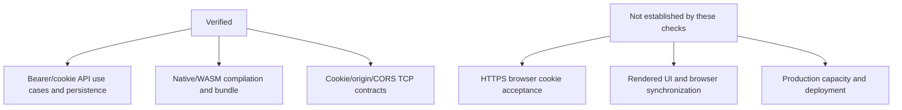

# Verification — 2026-10-13

| Record | Scope |
| --- | --- |
| Checkout | `feat/backoffice-admin-ui`, including uncommitted API test-runner changes |
| Evidence | Observed cleanup runs on this date; API and backoffice native/WASM lint pass |
| Latest verification | Approved cleanup plus TOML-only API configuration: fresh-database native/retention/TCP tests, native/WASM lint, bundle, SQL metadata and manual startup checks; earlier client-ui results remain prior evidence |
| Related docs | [Architecture](architecture.md) · [Operations](development.md) |

## Results

| Check | Command / recipe | Result |
| --- | --- | --- |
| API unit tests | API `just test`: native tests before Compose starts | 31 passed; retention ignored here |
| API TCP E2E | API `just test`: local API + shared Docker PostgreSQL | 36 passed, including cookie/origin/CORS/bearer precedence contracts; optional bootstrap script/tests removed |
| Startup failure cleanup | Invalid `E2E_API_PORT`: recipe failure check and filtered healthz test with temporary TOML | Expected nonzero exit; owned config/API removed; E2E database volume deleted |
| Repository skills | Bundled `quick_validate.py` for both existing skills | Both passed |
| PostgreSQL retention | `cargo api-e2e`: includes ignored API library tests after Compose starts | 1 retention test passed; 31 native tests rerun |
| Backoffice unit tests | Backoffice `just test` | 6 passed, including nested-route/base-path/invalid-URL regressions |
| Domain contract | `cargo test --locked --offline -p domain` | 1 contract test passed |
| API strict lint | `cargo clippy --locked --offline -p api --all-targets -- -D warnings` | Passed after cookie/token middleware split |
| Backoffice native strict lint | Backoffice `just check` | Passed after moving the asset macro to module scope |
| UI WASM strict lint | Backoffice `just check` | Passed |
| Domain WASM | `cargo check --locked --offline -p domain --target wasm32-unknown-unknown` | Passed |
| Format | `cargo fmt --all --check` | Passed |
| SQLx metadata | API `cargo sqlx prepare --check -- --lib`; online against existing PostgreSQL | Passed |
| Dioxus web bundle | Backoffice `just build` | Passed with absolute config resolution and explicit client statuses; public TOML bundled |
| Client UI workflows | Package `just setup`, `run`, `test`, `check` | Passed; run prints stub, zero test cases |
| Domain workflows | Package `just setup`, `test`, `check` | Passed; includes contract and WASM checks |

## E2E execution

```mermaid
flowchart LR
    UNIT["cargo test: native API tests"] --> PG["Compose up: PostgreSQL"]
    PG --> CARGO["cargo api-e2e: retention and TCP tests"]
    CARGO --> HARNESS["Harness: configure and launch local API"]
    HARNESS --> READY["Harness: wait for healthz"]
    READY --> TCP["36 real TCP endpoint tests"]
    TCP --> STOP["Harness: stop owned API"]
    STOP --> DOWN["Compose down -v: delete test database"]
```

| Resource | Handling |
| --- | --- |
| Docker context / DB port | `orbstack` / 5433 |
| Application | Harness owns child-process environment, local API startup, readiness and teardown; real endpoint requests |
| E2E location | `services/api/e2e-test/main.rs`, `healthz.rs`, `v1/{auth,admins}.rs` |
| Database lifecycle | Shared within a run; Compose down `-v` deletes the database afterward, including on failure |
| Endpoint fixtures | Unique owned rows and race controls; scoped cleanup |
| Retention fixtures | Connection-owned temporary rows |

## Exercised behavior

| Area | Covered scenarios |
| --- | --- |
| Login/access | Credentials, malformed JSON, malformed/expired/wrongly signed JWTs; cookie identity response and explicit bearer precedence |
| Cookie transport | Login/rotation/replay/logout, family isolation, self-update revocation, missing/null/foreign Origin and trusted/foreign preflight |
| Cookie attributes | Native development and production creation/removal name, path, Secure, HttpOnly, Lax and no Domain |
| Localhost browser fix | UI/API TOML defaults aligned to localhost; exact-origin preflight passed; in-app browser renders Sign in at http://localhost:8084 |
| Local API startup | just run succeeded with invalid API_HOST/API_PORT/PUBLIC_ORIGIN/INSECURE_LOCAL_COOKIES environment values; TOML settings retained |
| Refresh | Single-use, concurrent winner, expiry, replacement rollback |
| Revocation | Family isolation, account-wide revocation, access-JWT persistence |
| In-flight policy | Verified login can issue after concurrent password update |
| Admins | Permissions, missing records, validation, duplicate usernames, pagination |
| Transactions | Failed revocation rolls back account update |
| Backoffice units | Stale response ownership; configured API URL and cookie mode; reject requests before settings; nested-route/base-path/invalid URL asset resolution |
| Coordination smoke | Temporary bundle without navigator.locks shows coordination error and Retry; status branch uses 503 |
| Domain contract | Stable roles; public admin serialization excludes credentials |

## Limits

| Gap | Meaning / existing follow-up location |
| --- | --- |
| Startup smoke | Safari: nested `/admins?page=2` loads config then login; temporary missing/malformed TOML shows error/Retry with no API fetch. Restoring valid TOML resumes API fetch; temporary port 8094 is outside configured CORS origin |
| Browser limits | Manual startup smoke does not establish full UI, session coordination or HTTPS cookie acceptance |
| Planned environments | Local/prod frontend files and deployment selection are not implemented |
| HTTPS browser acceptance | Cookie attributes are checked natively; local TCP tests cover cookie/origin/CORS contracts, but do not establish HTTPS browser acceptance |
| Browser behavior | Web Locks, BroadcastChannel, cookie acceptance and rendered pagination are not verified by compilation |
| Backoffice/browser E2E | Excluded by request |
| Removed tests | Two tests specific to the deleted optional bootstrap script removed; BFF/custom-pagination counts no longer apply |
| Coverage percentages | Not rerun for current architecture; earlier percentages omitted |
| Capacity | Passing tests do not establish production throughput |
| Independent review | Cleanup `cafe9ab..924aef2`: no validated functional blockers; two stale architecture rows corrected. Earlier branch changes inspected as context, not exhaustively re-audited |
| Vercel/deployment | No runtime adapter, production deployment, push or merge |

## API error logging — 2026-10-13

| Check | Result |
| --- | --- |
| `just --justfile services/api/justfile check` | Formatting and strict lint passed |
| `just --justfile services/api/justfile test` | Native: 38 passed, 2 Docker-dependent tests deferred; Docker phase: all 40 library tests and 36 real HTTP E2E tests passed; Compose teardown completed |
| Logging regressions | All 9 passed, including PostgreSQL username-conflict source preservation on a connection-owned temporary table |
| Parallel capture stability | 15 consecutive parallel native runs passed after replacing short-lived subscribers with one stable subscriber and thread-local real filters/output |
| Regression evidence | Missing HTTP/password origin, nested/background diagnostics, JWT validation diagnostic, and PostgreSQL conflict diagnostic reproduced before their fixes |
| Built API startup | Invalid signing-key configuration: one ERROR summary with configuration origin; diagnostic details present only with `RUST_LOG=info,api=debug` |
| Independent review | Direct pool/transaction origin gaps and conflict source loss corrected; no remaining blockers |
| Limits | DEBUG detail tests cover password parsing, pool closure, JWT validation, PostgreSQL conflicts and nested anyhow/background errors; they do not establish all driver errors, browser behavior or production log collection |

## ENZ-5 Shopify client — 2026-10-16

| Check | Observed result |
| --- | --- |
| Baseline `cargo test --locked -p api --lib` | 38 passed, 2 Docker-dependent tests ignored |
| Transport RED / GREEN | Seven behavior tests failed against stubs, then all seven passed |
| Token loading RED / GREEN | Configuration returned no token before loading was implemented; configuration tests passed afterward |
| Six Shopify operations RED / GREEN | Six behavior tests failed against stubs; all passed after implementation |
| Native regression suite | 62 passed, 2 ignored before final review; final checks recorded below |
| Scope | Local loopback HTTP contract/integration fixtures; no live Shopify requests, inventory mutations, or E2E execution |

| Coverage | Exercised behavior |
| --- | --- |
| Transport | Typed JSON, generic headers, HTTP/GraphQL errors, partial data, missing data, malformed JSON, no redirects, timeout |
| Retry | 429 and GraphQL THROTTLED, exact replay, four-attempt exhaustion, Retry-After minimum/budget, no HTTP 5xx retries |
| Pagination | Multiple product/variant and order/line pages; missing/repeated/cyclic cursors; all inventory pages |
| Contracts | Decimal money and currency, nullable references, all sales statuses/test orders, search escaping, empty tag replacement and mutation user errors |
| Stock | Positive inactive tracked stock only; quantity arguments omitted on activation; retained quantities and idempotency key |

Limits: native fixtures establish client contracts, not live Shopify schema execution, actual inventory changes, production throughput, or a consistent snapshot during concurrent catalog edits. E2E was explicitly excluded. Existing repository CI remains unchanged.

| Final local check | Result |
| --- | --- |
| `just test-native` | 63 passed, 0 failed, 2 pre-existing Docker-dependent tests ignored |
| `just check` | API format and strict Clippy passed |
| `cargo fmt --all -- --check` | Passed |
