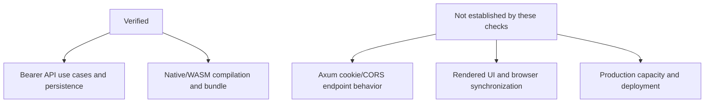

# Verification — 2026-10-13

| Record | Scope |
| --- | --- |
| Checkout | `feat/backoffice-admin-ui`, including uncommitted API test-runner changes |
| Evidence | Last observed runs on this date; latest API middleware split passed, latest backoffice native/WASM lint failed |
| Latest verification | Simplified API runner: fresh-database unit/retention/TCP tests, format, strict API lint and skill validation passed; other results below remain prior evidence |
| Related docs | [Architecture](architecture.md) · [Operations](development.md) |

## Results

| Check | Command / recipe | Result |
| --- | --- | --- |
| API unit tests | API `just test`: native tests before Compose starts | 29 passed; retention ignored here |
| API TCP E2E | API `just test`: local API + shared Docker PostgreSQL | 31 passed |
| Startup failure cleanup | API `just test` with invalid `E2E_API_PORT` | Expected nonzero exit; no E2E container or API process remains |
| Repository skills | Bundled `quick_validate.py` for both existing skills | Both passed |
| PostgreSQL retention | `cargo api-e2e`: includes ignored API library tests after Compose starts | 1 retention test passed; 29 native tests rerun |
| Backoffice unit tests | `cargo test --locked --offline -p backoffice --lib` | 3 passed |
| Domain contract | `cargo test --locked --offline -p domain` | 1 contract test passed |
| API strict lint | `cargo clippy --locked --offline -p api --all-targets -- -D warnings` | Passed after cookie/token middleware split |
| Backoffice native strict lint | `cargo clippy --locked --offline -p backoffice --all-targets -- -D warnings` | **Failed**: config.rs `unsafe_derive_deserialize` |
| UI WASM strict lint | `cargo clippy --locked --offline -p backoffice --no-default-features --features web --target wasm32-unknown-unknown --all-targets -- -D warnings` | **Failed**: same config.rs lint |
| Domain WASM | `cargo check --locked --offline -p domain --target wasm32-unknown-unknown` | Passed |
| Format | `cargo fmt --all --check` | Passed |
| SQLx metadata | API `cargo sqlx prepare --check -- --lib`; online against existing PostgreSQL | Passed |
| Dioxus web bundle | Backoffice `just build` | Passed after startup/API relocation; public TOML asset bundled |
| Client UI workflows | Package `just setup`, `run`, `test`, `check` | Passed; run prints stub, zero test cases |
| Domain workflows | Package `just setup`, `test`, `check` | Passed; includes contract and WASM checks |

## E2E execution

```mermaid
flowchart LR
    UNIT["cargo test: native API tests"] --> PG["Compose up: PostgreSQL"]
    PG --> CARGO["cargo api-e2e: retention and TCP tests"]
    CARGO --> HARNESS["Harness: configure and launch local API"]
    HARNESS --> READY["Harness: wait for healthz"]
    READY --> TCP["31 real TCP endpoint tests"]
    TCP --> STOP["Harness: stop owned API"]
    STOP --> DOWN["Compose down -v: delete test database"]
```

| Resource | Handling |
| --- | --- |
| Docker context / DB port | `orbstack` / 5433 |
| Application | Harness owns child-process environment, local API startup, readiness and teardown; real endpoint requests |
| E2E location | `services/api/e2e-test/main.rs`, `healthz.rs`, `v1/{auth,admins}.rs` |
| Database lifecycle | Shared within a run; Compose down `-v` deletes the database afterward, including on failure |
| Endpoint fixtures | Unique owned rows and race controls; scoped cleanup |
| Retention fixtures | Connection-owned temporary rows |

## Exercised behavior

| Area | Covered scenarios |
| --- | --- |
| Login/access | Credentials, malformed JSON, malformed/expired/wrongly signed JWTs |
| Refresh | Single-use, concurrent winner, expiry, replacement rollback |
| Revocation | Family isolation, account-wide revocation, access-JWT persistence |
| In-flight policy | Verified login can issue after concurrent password update |
| Admins | Permissions, missing records, validation, duplicate usernames, pagination |
| Transactions | Failed revocation rolls back account update |
| Bootstrap SQL | Field/hash validation, usable Argon2 hash, duplicate race without overwrite |
| Backoffice units | Stale response ownership; configured API URL and cookie-mode header; reject API calls before configuration |
| Domain contract | Stable roles; public admin serialization excludes credentials |

## Limits

| Gap | Meaning / existing follow-up location |
| --- | --- |
| Config runtime defect | Relative `/assets/application.toml` is passed to reqwest without resolving browser origin; compilation/request-builder tests do not exercise that fetch |
| Strict lint | Both backoffice targets fail on asset macro expansion in deserialized Settings impl; no code fix made during reconciliation |
| Planned environments | Local/prod frontend files and deployment selection are not implemented |
| Cookie/CORS API path | Login/refresh/logout cookie responses, attributes, Origin rejection, preflight and bearer precedence lack endpoint tests; use existing `services/api/e2e-test/v1/{auth,admins}.rs` |
| Browser behavior | Web Locks, BroadcastChannel, cookie acceptance and rendered pagination are not verified by compilation |
| Backoffice/browser E2E | Excluded by request |
| Removed tests | BFF/custom-pagination counts no longer apply |
| Coverage percentages | Not rerun for current architecture; earlier percentages omitted |
| Capacity | Passing tests do not establish production throughput |
| Independent review | No fresh architecture review of current simplifications in this verification pass |
| Vercel/deployment | No runtime adapter, production deployment, push or merge |
